# 📄 Editor PDF Portable

[](https://github.com/Fede1771/Editor-portable/releases)
[](https://github.com/Fede1771/Editor-portable/releases/latest)
[](#-privacidad-y-almacenamiento)
[](Proyecto/tests)

> **Editor de PDF de escritorio para Windows, con procesamiento local y distribución portable.**
>
> Leé documentos, editá texto, organizá páginas, modificá tablas vectoriales, aplicá OCR local, censurá contenido, completá formularios y comprimí archivos. También podés crear PDFs a partir de imágenes, HTML, texto o documentos de Office. La conversión de Office requiere la aplicación de escritorio correspondiente, instalada y activada.

---

## 📑 Tabla de Contenidos

- [⬇️ Descarga del portable (Usuarios)](#️-descarga-del-portable-usuarios)
- [💻 Requisitos del usuario final](#-requisitos-del-usuario-final)
- [⚡ Inicio rápido para usuarios](#-inicio-rápido-para-usuarios)
- [⚖️ ¿Por qué elegir Editor PDF Portable?](#️-por-qué-elegir-editor-pdf-portable)
- [🧭 Navegación por la nueva barra compacta](#-navegación-por-la-nueva-barra-compacta)
- [📊 Guía específica de edición de tablas](#-guía-específica-de-edición-de-tablas)
- [🗂️ Guía de uso por tareas](#️-guía-de-uso-por-tareas)
- [⌨️ Atajos de teclado verificados](#️-atajos-de-teclado-verificados)
- [🛠️ Tecnologías y arquitectura (Herramientas utilizadas)](#️-tecnologías-y-arquitectura)
- [⚠️ Limitaciones técnicas reales y consideraciones](#️-limitaciones-técnicas-reales-y-consideraciones)
- [❓ Preguntas frecuentes (FAQ)](#-preguntas-frecuentes-faq)
- [👨‍💻 Guía de desarrollo y compilación](#-guía-de-desarrollo-y-compilación)
- [📚 Documentación técnica complementaria](#-documentación-técnica-complementaria)
- [🔒 Privacidad y almacenamiento](#-privacidad-y-almacenamiento)

---

## ⬇️ Descarga del portable (Usuarios)

No requiere instalación, permisos de administrador ni dependencias previas de Python o Java. Descargás, extraés y ejecutás.

[](https://github.com/Fede1771/Editor-portable/releases/latest/download/EditorPDFPortable.zip)

- **Descarga directa de la última versión:** [EditorPDFPortable.zip](https://github.com/Fede1771/Editor-portable/releases/latest/download/EditorPDFPortable.zip)
- **Historial de versiones y notas de publicación:** [Releases en GitHub](https://github.com/Fede1771/Editor-portable/releases)

---

## 💻 Requisitos del usuario final

- **Sistema Operativo:** Windows 10 o Windows 11 (ediciones de 64 bits).
- **Entorno de ejecución:** El ZIP incluye Python y las bibliotecas de la app. Extraelo en una carpeta con permisos de lectura y escritura; las políticas del equipo pueden restringir la ejecución desde USB o ubicaciones de red.
- **Microsoft 365 de escritorio (opcional):** Únicamente necesario si deseás crear PDFs a partir de documentos de Word (`.docx`), Excel (`.xlsx`) o PowerPoint (`.pptx`) mediante `Ctrl + N`. Todas las demás funciones (lectura, edición de texto, maquetación, tablas, anotaciones, OCR, formularios, compresión y exportación a imágenes) son completamente autónomas e independientes de Office.

---

## ⚡ Inicio rápido para usuarios

1. **Descargá el archivo comprimido** [`EditorPDFPortable.zip`](https://github.com/Fede1771/Editor-portable/releases/latest/download/EditorPDFPortable.zip).
2. **Extraé el archivo ZIP** en cualquier carpeta de tu disco o memoria USB.
   > **Importante:** La carpeta descomprimida `EditorPDFPortable/` contiene el ejecutable `EditorPDFPortable.exe`, el acceso directo `Abrir_EditorPortable.bat` y la subcarpeta `_internal/`. **Es indispensable conservar la carpeta `_internal/` junto al ejecutable**, ya que contiene el motor y las bibliotecas necesarias para su funcionamiento.
3. **Iniciá el programa** haciendo doble clic en `EditorPDFPortable.exe` o en `Abrir_EditorPortable.bat`.
4. **Abrí tu documento:**
   - Arrastrá cualquier archivo PDF directamente sobre la ventana.
   - Presioná `Ctrl + O` (o hacé clic en **Archivo → Abrir**) para seleccionar un archivo.
   - Presioná `Ctrl + N` para crear un PDF nuevo combinando imágenes o documentos.

---

## ⚖️ ¿Por qué elegir Editor PDF Portable?

| Característica | Qué ofrece | Consideración práctica |
|---|---|---|
| **Procesamiento local** | Edición y OCR en el equipo. | Office, enlaces e impresoras tienen su propia configuración y comportamiento. |
| **Tablas vectoriales** | Inserción y eliminación de filas y columnas, con altura en mm y barra contextual. | Requiere una grilla detectable y espacio para realizar la operación. |
| **Distribución portable** | ZIP con runtime de Python y bibliotecas incluidos. | Conservá `_internal/`; las preferencias y los temporales pueden escribirse en el equipo. |
| **OCR español e inglés** | Reconocimiento local mediante Tesseract y modelos incluidos. | No reconstruye automáticamente una tabla editable desde un escaneo. |
| **Office → PDF** | Exportación con Word, Excel o PowerPoint. | Requiere la aplicación de escritorio correspondiente, instalada y activada. |

---

## 🧭 Navegación por la nueva barra compacta

Para maximizar el espacio útil de visualización del documento, la interfaz prescinde de cintas con múltiples pestañas permanentes que ocupaban espacio vertical valioso. En su lugar, utiliza dos franjas horizontales compactas y contextuales:

### Esquema de la interfaz:
```text
┌────────────────────────────────────────────────────────────────────────────────────────┐
│ [Archivo ▾]   [↶ Deshacer] [↷ Rehacer]   [◀] 1 / 15 [▶]   [ 100% ▾ ]   [🔍 Herramientas] │ <- Franja de navegación
├────────────────────────────────────────────────────────────────────────────────────────┤
│ [🔤 Seleccionar] [✍ Editar texto] [⬛ Censurar] [🖼 Imagen] [🖐 Mano] [📐 Tablas ▾] ...   │ <- Herramientas frecuentes
└────────────────────────────────────────────────────────────────────────────────────────┘
```

1. **Franja superior de navegación y archivo:**
   - Botón **Archivo** (abrir, guardar, imprimir, cerrar).
   - Botones rápidos de **Deshacer** (`Ctrl + Z`) y **Rehacer** (`Ctrl + Y`).
   - Controles de navegación de página (anterior, siguiente, selector numérico y total de páginas).
   - Selector de zoom y ajuste de visualización (ancho o página completa).
   - Botón **Herramientas** (`Ctrl + K`): Buscador universal de herramientas.
2. **Franja inferior de herramientas frecuentes y grupos:**
   - Accesos directos a las herramientas principales: **Seleccionar** (`V`), **Editar texto** (`T`), **Censurar** (`R`), **Imagen** (`I`), **Mano** (`H`) y el botón principal de **Tablas** (`B`).
   - Menús agrupados:
     - **Tablas:** Acceso directo a edición interactiva y diálogo de ampliación avanzada.
     - **Anotar:** Resaltador, subrayador, tachador, notas adhesivas, lápiz libre y enlaces.
     - **Páginas:** Rotación, extracción, eliminación, combinación e inserción de páginas en blanco.
     - **Documento:** OCR local, compresión, formularios AcroForms, adjuntos y metadatos.
3. **Diseño responsivo y adaptabilidad (`FlowLayout`):**
   - Los controles se distribuyen de manera fluida según el ancho disponible de la ventana.
   - En pantallas pequeñas o ventanas angostas, los botones secundarios pasan automáticamente a modo de solo icono, evitando menús de desborde engorrosos.
4. **Buscador rápido de herramientas (`Ctrl + K`):**
   - Permite encontrar cualquier funcionalidad del editor escribiendo su nombre (por ejemplo: `rotar`, `ocr`, `comprimir`, `tabla`, `censurar`).
   - El buscador normaliza el texto ingresado, permitiendo encontrar funciones sin importar el uso de mayúsculas o acentos.

---

## 📊 Guía específica de edición de tablas

El editor incluye un **motor de edición vectorial de tablas** (`app/table_edit.py`) diseñado para modificar la estructura de grillas existentes sin convertir la página en una imagen rasterizada ni alterar la identidad del objeto `Page`.

### Flujo de trabajo paso a paso:

```mermaid
flowchart LR
    A["1. Abrir PDF con tabla detectable"] --> B["2. Seleccionar una celda con 'V' o 'B'"]
    B --> C["3. Identificar fila y columna en barra contextual"]
    C --> D["4. Insertar / Eliminar filas o columnas"]
    D --> E["5. Ajustar alto en mm y ver vista previa"]
    E --> F["6. Aplicar cambios"]
    F --> G["7. Deshacer / Rehacer (Ctrl+Z / Ctrl+Y)"]
    G --> H["8. Guardar (Ctrl+S)"]
```



1. **Abrir el documento:** Abrí cualquier PDF que contenga una tabla estructurada con bordes vectoriales detectables.
2. **Seleccionar una celda:**
   - Con la herramienta de puntero habitual **Seleccionar** (`V`), hacé clic en cualquier celda de la tabla.
   - También podés presionar la tecla `B` o hacer clic en el botón **Tablas** de la barra de herramientas.
3. **Identificar la celda:** La celda seleccionada se resaltará en pantalla y se abrirá la barra contextual de tablas indicando el número de tabla, la fila y la columna seleccionada (por ejemplo: `Tabla 1 · Fila 2 · Columna 3`).
4. **Insertar o eliminar elementos:**
   - **Insertar fila debajo / arriba:** El menú desplegable del botón de filas permite agregar una nueva fila vacía. La fila nueva hereda automáticamente el estilo de los bordes, el color de relleno y la estructura de columnas de la fila adyacente.
   - **Insertar columna a la derecha / izquierda:** Agrega una columna vacía redistribuyendo de forma proporcional el ancho de la tabla, respetando los encabezados combinados horizontalmente.
   - **Eliminar fila seleccionada:** Quita la fila y su contenido, desplazando hacia arriba el contenido inferior del documento para cerrar el espacio vacío.
   - **Eliminar columna seleccionada:** Remueve las celdas de la columna y redistribuye las restantes dentro del ancho original de la tabla.
5. **Ajustar el alto de la fila con vista previa:**
   - En el control numérico **Alto (mm)**, ingresá la medida deseada. A medida que modificás el valor, se muestra una **vista previa en tiempo real** sobre la página indicando cómo quedará la fila antes de confirmar.
   - **Arrastre interactivo con el mouse:** También podés posar el cursor sobre el borde inferior de la fila seleccionada (el cursor cambiará a flecha vertical de redimensionado `↕`) y arrastrarlo hacia abajo para estirar la fila elásticamente.
6. **Aplicar los cambios:** Hacé clic en **Aplicar** para consolidar la modificación vectorial en la página.
7. **Deshacer y Rehacer:** Si cometés un error, podés deshacer inmediatamente con `Ctrl + Z` (o el botón *Deshacer* de la barra de tabla) y rehacer con `Ctrl + Y`. Cada operación crea un snapshot en el historial de la pestaña.
8. **Guardar el documento:** Presioná `Ctrl + S` para guardar las modificaciones o `Ctrl + Shift + S` para generar una copia nueva.

### Ampliación avanzada de tablas:
Si necesitás estirar una página completa o realizar un corte por coordenadas verticales arbitrarias $Y$, podés acceder al menú **Tablas → Ampliación avanzada…**, donde podés configurar el incremento en puntos y definir si la altura total de la página debe expandirse para conservar márgenes.

---

## 🗂️ Guía de uso por tareas

### 1. Lectura y navegación de documentos
- **Vistas flexibles:** Alterná entre visualización continua, una sola página o doble página enfrentada.
- **Zoom fluido:** Modos de zoom preestablecidos, ajuste automático al ancho (`Ctrl + 1`), ajuste a página completa (`Ctrl + 2`) y zoom libre mediante `Ctrl + rueda del mouse`.
- **Navegación de miniaturas:** Panel lateral con vista previa de páginas para saltar de forma inmediata a cualquier sección.
- **Rotación visual de vista:** Rotá la orientación de lectura en incrementos de 90° en sentido horario o antihorario.
- **Búsqueda interactiva (`Ctrl + F`):** Localizá palabras o frases con resaltado en tiempo real y navegación entre coincidencias.
- **Preservación de lectura:** Al editar texto, agregar elementos o deshacer/rehacer cambios, la vista mantiene intacta la posición de lectura y el desplazamiento de la página.

### 2. Edición de texto existente y nuevo
- **Edición en bloque:** Con la herramienta **Editar texto** (`T`), hacé clic sobre cualquier bloque o tarjeta de texto existente para modificar su contenido. El editor detecta automáticamente la tipografía original, tamaño, color, alineación e interlineado para integrarse armónicamente con el diseño del documento.
- **Inserción de nuevos textos:** Hacé clic y arrastrá sobre un espacio vacío para crear un nuevo cuadro de texto con formato personalizado.
- **Acciones rápidas con el mouse (Barra contextual flotante):** Al seleccionar cualquier fragmento de texto con la herramienta **Seleccionar** (`V`), aparece una barra flotante compacta junto a la selección con accesos inmediatos:
  - **Copiar** (`Ctrl + C`): Copia el texto seleccionado al portapapeles.
  - **Editar texto**: Abre el editor sobre el fragmento seleccionado.
  - **Resaltar** (`Shift + H`): Aplica resaltador translúcido sobre el texto.
  - **Subrayar** (`Shift + U`): Añade una línea de subrayado al texto seleccionado.
  - **Tachar** (`Shift + S`): Aplica un tachado sobre las palabras seleccionadas.

### 3. Organización y maquetación de páginas
- **Reordenamiento visual:** Reorganizá el orden de las páginas arrastrando y soltando sus miniaturas en el panel lateral.
- **Operaciones de página:** Duplicá páginas, rotalas permanentemente, insertá páginas en blanco en cualquier posición o eliminá páginas obsoletas.
- **Combinar y dividir PDFs:** Extraé páginas seleccionadas a un nuevo documento o combiná varios archivos en uno solo.
- **Diseño de membrete:** Agregá numeración de página automática, encabezados, pies de página o marcas de agua configurables.

### 4. Anotaciones y formularios interactivos
- **Herramientas de revisión:** Resaltado de texto, subrayado, tachado y herramienta de **Lápiz** (`P`) para trazados libres a mano alzada.
- **Notas adhesivas:** Insertá comentarios emergentes en cualquier ubicación de la página.
- **Formularios AcroForms:** Completá formularios digitales (campos de texto, casillas de verificación, botones de opción y listas desplegables).
- **Aplanar formularios:** Consolidá de forma definitiva los datos completados dentro del contenido gráfico de la página para que no puedan ser alterados o borrados.

### 5. Reconocimiento Óptico de Caracteres (OCR local)
- **Digitalización offline:** Convertí documentos escaneados e imágenes en PDFs con texto seleccionable, copiable y buscable.
- **Idiomas incluidos:** Soporte local integrado para español (`spa`) e inglés (`eng`) mediante archivos entrenados empaquetados en `Proyecto/data/tessdata/`.
- **Sin conexión:** El reconocimiento se ejecuta exclusivamente en el procesador local; tus documentos confidenciales nunca se transmiten a la nube.

### 6. Censura y sesión privada
- **Seleccionar áreas:** Con la herramienta **Censurar** (`R`), marcá las regiones que contienen los datos que querés eliminar del PDF.
- **Búsqueda automática de patrones:** Censurá automáticamente números de documento, correos electrónicos o términos específicos en todo el PDF.
- **Revisión del resultado:** La censura aplica operaciones de eliminación de contenido PDF. Revisá la copia guardada, los adjuntos, las anotaciones y los metadatos antes de compartirla; no equivale a borrar copias previas del archivo ni garantiza que no queden datos en otros objetos.
- **Modo Sesión Privada:** Evita registrar archivos recientes del editor y gestiona sus temporales. No controla cachés de Office, el sistema operativo, copias de seguridad o la cola de impresión.

### 7. Optimización y compresión inteligente
- **Perfiles preconfigurados:** Reducí el peso del archivo según el destino (envío por correo, archivo digital liviano o documentos de alta fidelidad).
- **Compresión visual:** Reescalado inteligente de DPI y compresión JPEG de mapas de bits, preservando la nitidez de textos vectoriales y líneas.

### 8. Creación de documentos y exportación a imágenes
- **Crear PDF desde archivos (`Ctrl + N`):** Generá documentos unificando imágenes (`.png`, `.jpg`, `.bmp`, `.tiff`) o archivos de Office (`.docx`, `.xlsx`, `.pptx` si contás con Microsoft 365 local instalado).
- **Exportar a imágenes:** Guardá páginas del PDF como imágenes independientes en alta resolución (PNG o JPEG) seleccionando rango de páginas y resolución (DPI).
- **Gestor de adjuntos (`Ctrl + Shift + A`):** Consultá, extraé, incrustá o eliminá archivos adjuntos embebidos en el PDF.

#### Convertir Word, Excel o PowerPoint a PDF

1. Abrí una vez la aplicación de escritorio correspondiente y verificá que esté activada y sin avisos de configuración pendientes. Office web no es suficiente.
2. En el editor, presioná **Ctrl + N**, elegí el documento y confirmá el orden en el diálogo de creación. Para Word se aceptan `.docx`, `.doc`, `.rtf` y `.odt`; para Excel `.xlsx`, `.xls` y `.ods`; para PowerPoint `.pptx`, `.ppt` y `.odp`. La compatibilidad concreta depende de la versión instalada de Office.
3. Esperá la conversión. El editor abre el documento de origen como solo lectura y recibe un PDF nuevo; no guarda cambios sobre el archivo de Office.
4. Revisá las páginas de la pestaña nueva y presioná **Ctrl + S** para elegir dónde guardar el resultado.

Si falla, conservá el mensaje completo del aviso. Revisá instalación y activación, contraseña o Vista protegida, permisos de lectura/escritura, fuentes y posibles diálogos pendientes. PowerPoint debe estar cerrado antes de convertir. El límite predeterminado es de 240 segundos por trabajo; los detalles de aislamiento y diagnóstico están en la [guía de Microsoft 365](Proyecto/docs/MICROSOFT365.md).

**Si aparece `Word.Application.Documents`:** falló el acceso a la automatización de Word. La versión actual incluye una consulta alternativa a COM y reintentos acotados cuando Word está ocupado. Si persiste en un equipo concreto, ejecutá el [diagnóstico opcional `--self-test-office`](Proyecto/docs/MICROSOFT365.md#diagnóstico-de-word-en-otro-equipo) y conservá `office_self_test_result.json` para revisar la causa con soporte. Que convierta en otro equipo no prueba que la instalación corporativa esté configurada igual.

### 9. Impresión nativa (`Ctrl + P`)
- Integración con los controladores de Windows mediante **QtPrintSupport (`QPrinter`)**, permitiendo elegir impresoras locales o de red, configurar rangos o imprimir las páginas seleccionadas en las miniaturas, incluyendo las ediciones en curso.

---

## ⌨️ Atajos de teclado verificados

| Atajo | Acción | Contexto |
|---|---|---|
| `Ctrl + O` | Abrir documento PDF | Global |
| `Ctrl + S` | Guardar cambios en el documento actual | Global |
| `Ctrl + Shift + S` | Guardar como copia nueva | Global |
| `Ctrl + N` | Crear PDF desde archivos (imágenes u Office) | Global |
| `Ctrl + W` | Cerrar la pestaña actual | Global |
| `Ctrl + P` | Imprimir documento mediante diálogo nativo | Global |
| `Ctrl + F` | Buscar texto en el documento | Visor |
| `Ctrl + K` | Abrir el buscador de herramientas por nombre | Global |
| `Ctrl + C` | Copiar el texto seleccionado al portapapeles | Selección |
| `Ctrl + Z` | Deshacer la última acción | Historial |
| `Ctrl + Y` | Rehacer la última acción deshecha | Historial |
| `V` | Activar herramienta de selección y puntero | Herramientas |
| `T` | Activar herramienta de edición de texto | Herramientas |
| `B` | Activar herramienta de edición de tablas | Herramientas |
| `R` | Activar herramienta de censura permanente | Herramientas |
| `I` | Insertar imagen en la página | Herramientas |
| `H` | Activar herramienta de desplazamiento (Mano) | Herramientas |
| `P` | Activar herramienta de dibujo libre (Lápiz) | Herramientas |
| `L` | Insertar enlace web o salto interno | Herramientas |
| `Shift + H` | Resaltar texto o área | Anotaciones |
| `Shift + U` | Subrayar texto | Anotaciones |
| `Shift + S` | Tachar texto | Anotaciones |
| `Ctrl + 1` | Ajustar vista al ancho de la página | Visualización |
| `Ctrl + 2` | Ajustar vista a la página completa | Visualización |
| `Ctrl + +` / `Ctrl + -` | Aumentar / Reducir nivel de zoom | Visualización |
| `Ctrl + Shift + C` | Comprimir y optimizar tamaño del PDF | Documento |
| `Ctrl + Shift + A` | Administrador de archivos adjuntos embebidos | Documento |
| `Esc` | Cerrar barra contextual de tablas o cancelar selección | Interacción |

---

## 🛠️ Tecnologías y arquitectura

El editor es una **aplicación de escritorio para Windows** escrita en Python, con interfaz Qt y motores nativos para procesar documentos. La interfaz no utiliza frameworks web, navegadores embebidos ni Electron.


### Tecnologías principales: qué hacen y por qué se usan

Las versiones corresponden al [entorno fijado en el lock](Proyecto/requirements/requirements.lock). La columna «Por qué se usa» describe el criterio técnico que satisface cada componente; no pretende reconstruir decisiones históricas que no están documentadas.

| Tecnología | Qué hace en este proyecto | Por qué se usa |
|---|---|---|
| **Python / CPython 3.14 x64** | Ejecuta la aplicación, coordina la interfaz, las operaciones PDF y los procesos auxiliares. | Permite combinar bibliotecas de documentos con APIs de Windows y mantener la lógica en módulos legibles. El trabajo intensivo se apoya en bibliotecas nativas. |
| **PySide6 6.12.0 / Qt 6** | Proporciona ventanas, pestañas, diálogos, eventos, atajos, barras contextuales y gráficos de la interfaz. | Ofrece controles de escritorio, soporte HiDPI y señales para comunicar componentes sin construir una aplicación web. |
| **QtCore, QtGui y QtWidgets** | Gestionan señales, geometría, controles, imágenes, pintura y distribución adaptable de herramientas. | Comparten el mismo modelo de eventos y renderizado de Qt; evitan mantener varias bibliotecas de interfaz. |
| **QtPrintSupport** | `QPrinter`, el diálogo nativo y `QPainter` imprimen el documento que está en memoria, incluidas sus ediciones. | Permite seleccionar impresora, rangos y copias mediante los controladores instalados en Windows. La impresión del proyecto no se implementa mediante `win32print`. |
| **QSettings** | Conserva preferencias e historial; normalmente usa el Registro de Windows. Con `EDITORPDF_SETTINGS_DIR` escribe un INI aislado. | Centraliza la configuración y permite aislarla en pruebas sin modificar las preferencias reales. |
| **PyMuPDF 2.0 / MuPDF** | Abre y renderiza PDFs, extrae texto, detecta tablas, compone páginas, edita contenido, administra anotaciones, formularios y cifrado. También convierte imágenes y maqueta HTML con `Story`. | Reúne lectura, dibujo y edición en un motor nativo. En las tablas permite reutilizar contenido vectorial en lugar de convertir toda la página en una imagen. |
| **pypdf 6.21.2** | Analiza objetos y streams PDF para formularios y apariencias; valida el PDF exportado por Office antes de publicarlo. | Complementa a MuPDF con acceso a estructuras PDF en Python. La validación de Office puede ejecutarse sin usar objetos PyMuPDF en el hilo receptor. |
| **Tesseract y modelos `spa` / `eng`** | Reconocen español e inglés mediante la integración OCR de MuPDF; los archivos `.traineddata` están en `Proyecto/data/tessdata/`. | Permiten obtener texto buscable de páginas escaneadas de forma local. No se invoca un `tesseract.exe` externo ni se requiere instalarlo aparte para el portable. |
| **pywin32 312** | Expone COM (`pythoncom`, `win32com.client`), mutex y funciones de Windows para identificar las instancias de Office. | Permite usar la exportación nativa de Office y controlar la instancia creada por el editor. |
| **Microsoft Word, Excel y PowerPoint de escritorio / COM** | Abren documentos en modo de lectura y los exportan a PDF con el motor de la aplicación correspondiente. Son dependencias externas opcionales, no incluidas en el ZIP. | Aprovechan el motor que interpreta los formatos Office. Requieren instalación y activación local; Microsoft 365 web no proporciona este servidor COM. La fidelidad depende también de fuentes, configuración de impresión y contenido del archivo. |
| **psutil 7.2.2** | Inspecciona PID, nombre y hora de creación de procesos; comprueba y limpia únicamente instancias identificadas como propias. | Reduce el riesgo de cerrar otra sesión de Office por confundirla con el trabajo de conversión. |
| **Windows WIA y Windows PowerShell** | El flujo de escáner abre `WIA.CommonDialog` desde un proceso PowerShell STA y recibe una imagen. | Reutiliza los dispositivos y controladores de escaneo compatibles con Windows. Se necesita un escáner con soporte WIA. |
| **Biblioteca estándar de Python** | `multiprocessing` con `spawn` aísla trabajos PDF/COM; `tempfile`, `pathlib`, `os.replace` y `shutil` gestionan archivos; `ctypes` consulta APIs de Windows; `json`, `re`, `html` y `urllib.parse` manejan datos y validaciones. | Resuelve coordinación, temporales y publicación atómica sin agregar dependencias para tareas que Python ya cubre. Los objetos Qt, COM y PDF no se comparten entre procesos. |
| **PyInstaller 6.22.3** | Empaqueta Python, módulos, DLL y recursos en una distribución `onedir` con ejecutable y carpeta `_internal/`. | Permite distribuir la app a equipos sin Python. Empaqueta el runtime; no elimina la dependencia opcional de Office. |
| **Tcl/Tk del splash de PyInstaller** | Presenta la imagen de inicio configurada en el archivo `.spec`, antes de que se muestre la ventana Qt. | Permite dar una indicación temprana de arranque; la interfaz principal sigue siendo PySide6. |
| **PDF, OOXML, HTML y CSS** | PDF es el formato de trabajo; Office interpreta los formatos de Word/Excel/PowerPoint. MuPDF Story maqueta HTML y CSS para crear PDFs desde HTML o texto. | Reutilizan formatos documentales existentes. El soporte HTML/CSS de Story no equivale a un navegador completo ni ejecuta la interfaz de la aplicación. |
| **pytest 9.1.1** | Ejecuta pruebas de edición, guardado, seguridad, procesos e interfaz; utiliza documentos sintéticos y preferencias aisladas. | Permite reproducir regresiones y verificar fallos sin usar documentos personales. Las simulaciones de COM no sustituyen una prueba real con Office. |
| **Git y GitHub Releases** | Versionan el código y distribuyen el ZIP portable y las notas de cada publicación. | Separan el historial de fuentes de los binarios descargables. Git no es necesario para ejecutar el portable. |
| **Markdown y Mermaid** | Presentan la guía de uso, tablas técnicas y diagramas de arquitectura en el repositorio. | Mantienen la documentación junto al código en formatos revisables; no forman parte de la ejecución del editor. |

### Dependencias transitivas y herramientas del entorno

El lock también fija los paquetes siguientes. Algunos llegan por Qt, PyMuPDF o las herramientas de desarrollo; **estar instalados no significa que la aplicación importe su API o exponga sus funciones al usuario**. El código de `app/` importa directamente PySide6, PyMuPDF, pypdf, pywin32 y psutil. Esta tabla completa el inventario del lock, sin presentar sus dependencias como elecciones independientes del editor.

| Paquete y versión fijada | Función | Motivo de su presencia |
|---|---|---|
| **PySide6_Essentials 6.12.0** | Módulos básicos y bibliotecas Qt. | Es la base de los controles usados por PySide6. |
| **PySide6_Addons 6.12.0** | Módulos adicionales de Qt, entre ellos soporte de impresión. | Completa la distribución de PySide6. |
| **shiboken6 6.12.0** | Interoperabilidad entre objetos C++ de Qt y Python. | Es el runtime de los bindings de PySide6. |
| **PySide6_Pdf 6.12.0.140** | Bindings de Qt PDF. | Llega con la distribución de PySide6; el visor del editor utiliza PyMuPDF. |
| **PySide6_WebEngine 6.12.0.140** | Bindings del motor web de Qt. | Llega con PySide6; la interfaz del editor no usa un navegador embebido. |
| **pymupdf_layout 2.0** | Componentes de análisis de disposición de documentos. | Dependencia de la versión fijada de PyMuPDF; la detección de tablas del editor usa trazos y `lines_strict`. |
| **pymupdf4llm 2.0** | Utilidades de extracción de documentos orientadas a texto estructurado. | Dependencia de PyMuPDF 2.0; el editor no llama modelos de lenguaje ni ofrece un flujo RAG. |
| **NumPy 2.5.4** | Arrays y cálculo numérico. | Soporte numérico del entorno de procesamiento documental. |
| **ONNX Runtime (`onnxruntime`) 1.31.0** | Ejecución local de modelos en formato ONNX. | Forma parte de las dependencias del motor documental; el OCR de `app/ocr.py` usa Tesseract mediante MuPDF. |
| **opencv-python-headless 5.0.0.93** | Operaciones de visión e imágenes sin ventanas propias. | Soporte del entorno documental; no es el sistema de interfaz del editor. |
| **NetworkX 3.7** | Estructuras y algoritmos de grafos. | Dependencia declarada por PyMuPDF; no se usa directamente desde `app/`. |
| **PyYAML 6.0.3** | Lectura y escritura de YAML. | Dependencia del motor documental; la configuración propia del editor utiliza QSettings. |
| **tabulate 0.10.0** | Formateo de tablas de texto. | Dependencia declarada por PyMuPDF, no del control visual de tablas del editor. |
| **FlatBuffers 25.12.19 y protobuf 7.36.2** | Representación y serialización de datos estructurados. | Soporte de las bibliotecas de modelos y procesamiento del entorno. |
| **fonttools 4.67.0** | Inspección y manipulación de fuentes. | Herramienta auxiliar fijada en el entorno; sin importación directa en `app/`. |
| **lxml 6.1.3** | Procesamiento de XML y HTML. | Biblioteca auxiliar conservada en el lock; el HTML propio de la app se maqueta con MuPDF Story. |
| **fire 0.7.1 y termcolor 3.3.0** | Creación de interfaces de consola y formato de color. | Herramientas auxiliares del entorno; no construyen la interfaz Qt. |
| **typing_extensions 4.16.0** | Tipos y compatibilidad de anotaciones Python. | Soporte para bibliotecas que necesitan estas definiciones. |
| **altgraph 0.17.5** | Grafos de dependencias de módulos. | Ayuda a PyInstaller a analizar qué debe incluir en el paquete. |
| **pefile 2024.8.26** | Inspección de ejecutables PE de Windows. | Soporte del empaquetado de ejecutables y DLL. |
| **pyinstaller-hooks-contrib 2026.8** | Reglas de recolección de dependencias y recursos. | Complementa el análisis de PyInstaller para bibliotecas externas. |
| **pywin32-ctypes 0.2.3** | Implementaciones auxiliares de APIs Win32 mediante `ctypes`. | Dependencia de PyInstaller; la automatización Office de la app usa pywin32. |
| **packaging 26.3 y setuptools 84.2.0** | Interpretación de versiones y herramientas de distribución Python. | Soportan instalación, pruebas y empaquetado. |
| **iniconfig 2.3.1 y pluggy 1.7.0** | Configuración INI y sistema de complementos. | Infraestructura utilizada por pytest. |
| **Pygments 2.21.0 y colorama 0.4.6** | Resaltado y salida de consola compatible con Windows. | Mejoran los informes de pruebas y herramientas; no renderizan el PDF. |

El lock registra un entorno completo, no una lista mínima de importaciones. Antes de quitar paquetes auxiliares conviene resolver de nuevo las dependencias y verificar ejecución, pruebas y empaquetado.

### Gestión de dependencias:
- [`Proyecto/requirements/requirements.txt`](Proyecto/requirements/requirements.txt): Declara los rangos compatibles para la ejecución de la aplicación.
- [`Proyecto/requirements/requirements-dev.txt`](Proyecto/requirements/requirements-dev.txt): Añade las herramientas de desarrollo, empaquetado y pruebas.
- [`Proyecto/requirements/requirements.lock`](Proyecto/requirements/requirements.lock): Registro con las versiones exactas probadas en el entorno Windows x64 con CPython 3.14.

---

## ⚠️ Limitaciones técnicas reales y consideraciones

Para mantener total transparencia técnica y evitar expectativas no sustentadas en la naturaleza de los documentos PDF:

1. **Tablas con geometría vectorial detectable:** El motor contextual de tablas detecta celdas y filas a partir de líneas y trazos vectoriales existentes (`strategy="lines_strict"`). Documentos PDF escaneados o tablas incrustadas como imágenes planas no contienen vectores y no pueden ser detectadas ni editadas directamente sin un proceso previo de reconstrucción o vectorización.
2. **Orientación y recorte de página:** Las operaciones contextuales de tabla requieren páginas con rotación de 0° y sin recortes desplazados (`cropbox_position == (0, 0)`). En páginas rotadas o con recortes especiales, la barra contextual se desactiva para prevenir desplazamientos desalineados.
3. **Celdas combinadas verticalmente:** Si una fila está atravesada por celdas combinadas en sentido vertical (que abarcan múltiples filas contiguas), el sistema rechazará la eliminación o redimensionado de esa fila específica para evitar romper la integridad visual del bloque.
4. **Protección de contenido adyacente:** Al ampliar o eliminar una fila, el desplazamiento afecta el ancho vertical de la página. Si existen bloques de texto, imágenes o gráficos ubicados en los laterales de la tabla que resultarían cortados por la línea divisoria, la operación es bloqueada preventivamente con un aviso explícito al usuario.
5. **Conservación del tamaño de página vs. espacio inferior:** Las operaciones contextuales de tabla están diseñadas para **no modificar el tamaño físico del PDF**. Si se intenta ampliar una fila pero no hay suficiente margen en el pie de página para desplazar el contenido inferior sin recortarlo, la ampliación se rechaza. Para ampliar la página entera físicamente, debe utilizarse el diálogo de *Ampliación avanzada*.
6. **Redistribución de columnas:** Al insertar o eliminar columnas, el contenido de las celdas restantes se escala horizontalmente para conservar el ancho global de la tabla. Esto no constituye un motor universal de maquetación tipográfica (reflujo semántico de texto); textos muy extensos en columnas reducidas podrían comprimirse visualmente.
7. **Elementos interactivos en columnas:** Si la tabla contiene notas adhesivas, enlaces o campos de formulario interactivos incrustados en su interior que no puedan reubicarse con total precisión geométrica, la redistribución de columnas se bloqueará para proteger dichos elementos.
8. **Edición vs. Censura:** Eliminar una fila o columna es una operación de maquetación. Para quitar datos sensibles usá **Censurar** (`R`) y revisá el PDF guardado, incluidos otros objetos donde esa información pueda repetirse.

---

## ❓ Preguntas frecuentes (FAQ)

### ¿Por qué Windows SmartScreen muestra una advertencia al abrir el portable por primera vez?
Un ejecutable sin firma o con poca reputación de descarga puede activar SmartScreen. Verificá que provenga de las publicaciones de este repositorio y, cuando se publique, compará su SHA-256. Una compilación correcta o una suite de pruebas no certifican la ausencia de malware.

### ¿El programa deja archivos en mi computadora o toca el registro de Windows?
El paquete no necesita instalador, pero **sí puede guardar preferencias en el Registro de Windows** mediante QSettings y crear temporales para conversiones, OCR, escáner y adjuntos. Consultá [Privacidad y almacenamiento](#-privacidad-y-almacenamiento) para aislar las preferencias y conocer los límites de la limpieza.

### ¿Cómo sé si la tabla de mi PDF es editable con la nueva herramienta?
Probá haciendo clic en una celda con `V` o `B`: si la grilla vectorial es detectable, aparecerá la barra contextual. Poder seleccionar el texto no garantiza que exista una grilla editable. **El OCR agrega texto buscable a un escaneo, pero no reconstruye bordes vectoriales ni lo convierte en una tabla editable.**

### ¿Necesito tener Microsoft Office instalado para usar el editor?
No. Todas las funciones de lectura, edición de texto, maquetación de tablas, anotaciones, OCR, censura, compresión, formularios y exportación a imágenes funcionan de forma autónoma. Office solo es necesario si deseás crear un PDF directamente a partir de archivos `.docx`, `.xlsx` o `.pptx` mediante `Ctrl + N`.

---

## 👨‍💻 Guía de desarrollo y compilación

Esta sección está destinada a desarrolladores que deseen clonar el repositorio, ejecutar el editor desde el código fuente, ejecutar la suite de pruebas o compilar un nuevo binario portable.

### 1. Clonación del repositorio
```powershell
git clone https://github.com/Fede1771/Editor-portable.git "Editor portable"
cd "Editor portable"
```

### 2. Preparación del entorno virtual
Se recomienda utilizar **CPython 3.14 (x64)** en Windows:
```powershell
# Crear el entorno virtual en Proyecto\.venv
python -m venv Proyecto\.venv

# Instalar las versiones exactas probadas del archivo lock
.\Proyecto\.venv\Scripts\python.exe -m pip install -r Proyecto\requirements\requirements.lock
```

Si deseás instalar usando rangos de desarrollo:
```powershell
.\Proyecto\.venv\Scripts\python.exe -m pip install -r Proyecto\requirements\requirements-dev.txt
```

### 3. Ejecución desde el código fuente
Para iniciar el editor en modo de desarrollo:
```powershell
# Mediante el script de inicio
.\Proyecto\run.bat

# O directamente con Python
.\Proyecto\.venv\Scripts\python.exe Proyecto\main.py
```

### 4. Ejecución de la suite de pruebas
El proyecto cuenta con una batería completa de pruebas unitarias y de integración que validan operaciones vectoriales, seguridad, formularios, compresión y flujos de interfaz:
```powershell
.\Proyecto\.venv\Scripts\python.exe -m pytest Proyecto\tests -q
```
La cantidad cambia al incorporar regresiones; usá el resultado de la ejecución actual como referencia. Las pruebas de conversión con COM simulado no comprueban por sí solas la instalación real de Office.

### 5. Compilación del ejecutable portable y empaquetado ZIP
El script [`Proyecto/scripts/build_portable.py`](Proyecto/scripts/build_portable.py) automatiza la compilación con PyInstaller y genera la carpeta de distribución y el archivo ZIP:
```powershell
.\Proyecto\.venv\Scripts\python.exe Proyecto\scripts\build_portable.py
```
- **Directorio de salida:** `Programa/EditorPDFPortable/`.
- **Archivo empaquetado:** `Programa/EditorPDFPortable.zip`.
- **Parámetros opcionales:**
  - `--dist-dir <ruta>`: Especifica una carpeta de distribución personalizada.
  - `--work-dir <ruta>`: Especifica la carpeta de archivos temporales de compilación.
  - `--no-zip`: Omite la generación del archivo `.zip` final.

### 6. Autoprueba del binario compilado
El ejecutable generado incluye un modo de autodiagnóstico integrado que valida sus subsistemas sin abrir la interfaz gráfica:
```powershell
$check = Start-Process -FilePath '.\Programa\EditorPDFPortable\EditorPDFPortable.exe' -ArgumentList '--self-test', 'Proyecto\build\verificacion-release' -Wait -PassThru -WindowStyle Hidden
$check.ExitCode
Get-Content Proyecto\build\verificacion-release\self_test_result.json
```
Revisá el archivo de resultado generado en `Proyecto/build/verificacion-release/self_test_result.json`, el cual debe indicar `"ok": true` en las comprobaciones de:
- `independent_process`: Ejecución independiente sin dependencias externas.
- `images`: Carga y procesamiento correcto de mapas de bits.
- `encrypted_compression`: Cifrado y optimización segura.
- `ocr`: Detección del motor local y rutas de `tessdata`.

Esta autoprueba general **no incluye Word, Excel ni PowerPoint**. La conversión Office debe comprobarse aparte en un equipo con las aplicaciones instaladas, usando documentos sintéticos.

### 7. Solución de problemas durante la compilación
- **Archivos bloqueados (`PermissionError` o `Acceso denegado`):** Guardá tus documentos y cerrá la instancia que ejecuta el binario a reemplazar. Si quedó un proceso de prueba sin ventana, verificá su ruta y PID antes de finalizar exclusivamente ese proceso. Evitá cerrar todos los procesos por nombre: podrían contener documentos sin guardar.
- **Temporales del sistema en entornos restringidos:** Si el directorio temporal del sistema tiene restricciones de permisos, configurá un temporal local dentro del espacio de trabajo antes de compilar:
  ```powershell
  New-Item -ItemType Directory -Force Proyecto\build\test-temp | Out-Null
  $env:TEMP = Join-Path (Get-Location) 'Proyecto\build\test-temp'
  $env:TMP = $env:TEMP
  ```

---

## 📚 Documentación técnica complementaria

- [📐 Estructura detallada del proyecto y organización de archivos](Proyecto/docs/ESTRUCTURA.md)
- [🏢 Integración y seguridad COM con Microsoft 365 de escritorio](Proyecto/docs/MICROSOFT365.md)
- [🛡️ Registro técnico de auditoría y correcciones de seguridad](Proyecto/docs/auditoria/CORRECCIONES_AUDITORIA.md)
- [📦 Repositorio en GitHub](https://github.com/Fede1771/Editor-portable)
- [🐛 Canal de reportes y sugerencias](https://github.com/Fede1771/Editor-portable/issues)

---

## 🔒 Privacidad y almacenamiento

- Las operaciones PDF y OCR del editor se realizan localmente. Abrir enlaces, utilizar Office o imprimir en red puede implicar servicios externos ajenos al motor PDF.
- Las preferencias usan QSettings y, por defecto en Windows, el Registro. Para guardarlas en un INI propio al iniciar desde PowerShell:

  ```powershell
  $env:EDITORPDF_SETTINGS_DIR = Join-Path (Get-Location) 'preferencias'
  .\Programa\EditorPDFPortable\EditorPDFPortable.exe
  ```

- Las conversiones y otras operaciones crean temporales. El gestor intenta limpiar los archivos que identifica como propios y recuperar residuos tras un cierre inesperado; no garantiza borrado físico en SSD ni elimina rastros de terceros.
- No hay un archivo `LICENSE` en el árbol actual. Antes de redistribuir el código o los binarios, debe aclararse la licencia del proyecto y revisarse la de sus dependencias; este README no concede una licencia MIT por sí mismo.
