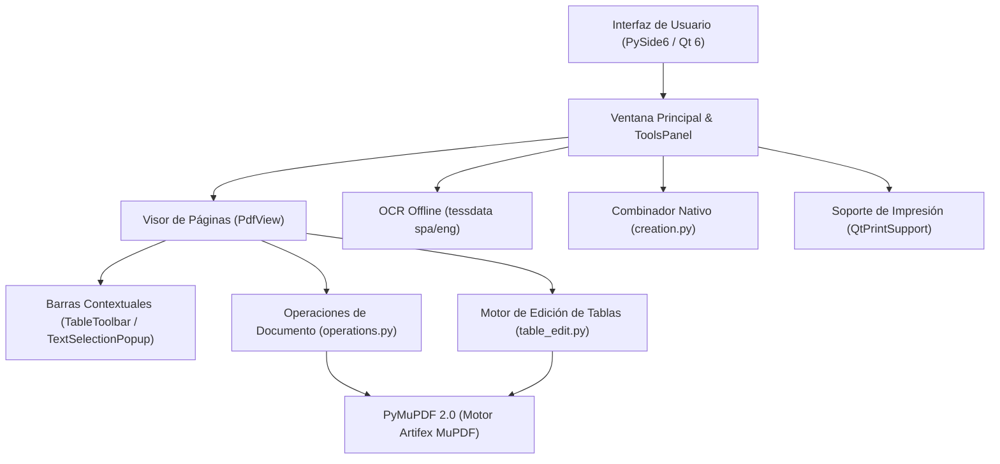

# 📄 Editor PDF Portable

[](https://github.com/Fede1771/Editor-portable/releases)
[](https://github.com/Fede1771/Editor-portable/releases/latest)
[](#-privacidad-y-almacenamiento)
[](#-requisitos-del-usuario-final)
[](Proyecto/tests)

> **Editor de PDF de escritorio para Windows, con procesamiento 100% local y distribución portable.**
>
> Leé documentos, editá texto, organizá páginas, modificá tablas vectoriales, combiná múltiples archivos e imágenes en un único PDF, aplicá OCR local, censurá contenido, completá formularios y comprimí archivos. Funciona de manera autónoma e independiente, sin requerir permisos de administrador ni instalaciones externas.

---

## 📑 Tabla de Contenidos

- [⬇️ Descarga del portable (Usuarios)](#️-descarga-del-portable-usuarios)
- [💻 Requisitos del usuario final](#-requisitos-del-usuario-final)
- [⚡ Inicio rápido para usuarios](#-inicio-rápido-para-usuarios)
- [⚖️ ¿Por qué elegir Editor PDF Portable?](#️-por-qué-elegir-editor-pdf-portable)
- [🧭 Navegación por la nueva barra compacta](#-navegación-por-la-nueva-barra-compacta)
- [📊 Guía específica de edición de tablas](#-guía-específica-de-edición-de-tablas)
- [🗂️ Guía de uso por tareas](#️-guía-de-uso-por-tareas)
- [⌨️ Atajos de teclado verificados](#️-atajos-de-teclado-verificados)
- [🛠️ Tecnologías y arquitectura (Herramientas utilizadas)](#️-tecnologías-y-arquitectura)
- [⚠️ Limitaciones técnicas reales y consideraciones](#️-limitaciones-técnicas-reales-y-consideraciones)
- [❓ Preguntas frecuentes (FAQ)](#-preguntas-frecuentes-faq)
- [👨‍💻 Guía de desarrollo y compilación](#-guía-de-desarrollo-y-compilación)
- [📚 Documentación técnica complementaria](#-documentación-técnica-complementaria)
- [🔒 Privacidad y almacenamiento](#-privacidad-y-almacenamiento)

---

## ⬇️ Descarga del portable (Usuarios)

No requiere instalación, permisos de administrador ni dependencias previas de Python o Java. Descargás, extraés y ejecutás.

[](https://github.com/Fede1771/Editor-portable/releases/latest/download/EditorPDFPortable.zip)

- **Descarga directa de la última versión:** [EditorPDFPortable.zip](https://github.com/Fede1771/Editor-portable/releases/latest/download/EditorPDFPortable.zip)
- **Historial de versiones y notas de publicación:** [Releases en GitHub](https://github.com/Fede1771/Editor-portable/releases)

---

## 💻 Requisitos del usuario final

- **Sistema Operativo:** Windows 10 o Windows 11 (ediciones de 64 bits).
- **Entorno de ejecución:** El ZIP incluye el motor de Python y todas las bibliotecas necesarias. Extraelo en una carpeta con permisos estándar de lectura y escritura (por ejemplo, en Documentos, Descargas o el Escritorio).
- **Permisos de usuario:** Funciona con privilegios de usuario estándar. **No requiere permisos de administrador** ni eleva privilegios (UAC), lo que permite utilizarlo sin inconvenientes en computadoras corporativas o equipos de trabajo con políticas de seguridad restrictivas.

---

## ⚡ Inicio rápido para usuarios

1. **Descargá el archivo comprimido** [`EditorPDFPortable.zip`](https://github.com/Fede1771/Editor-portable/releases/latest/download/EditorPDFPortable.zip).
2. **Extraé el archivo ZIP** en cualquier carpeta de tu disco o memoria USB.
   > **Importante:** La carpeta descomprimida `EditorPDFPortable/` contiene el ejecutable `EditorPDFPortable.exe`, el acceso directo `Abrir_EditorPortable.bat` y la subcarpeta `_internal/`. **Es indispensable conservar la carpeta `_internal/` junto al ejecutable**, ya que contiene el motor y las bibliotecas necesarias para su funcionamiento.
3. **Iniciá el programa** haciendo doble clic en `EditorPDFPortable.exe` o en `Abrir_EditorPortable.bat`.
4. **Abrí tu documento:**
   - Arrastrá cualquier archivo PDF directamente sobre la ventana.
   - Presioná `Ctrl + O` (o hacé clic en **Archivo → Abrir…**) para seleccionar un archivo existente.
   - Presioná `Ctrl + Shift + N` (o hacé clic en **Archivo → Combinar archivos…**) para unificar múltiples PDFs e imágenes en un documento nuevo.

---

## ⚖️ ¿Por qué elegir Editor PDF Portable?

Comparativa frente a las alternativas más comunes del mercado (servicios web en la nube y suites comerciales tradicionales):

| Característica | 📄 Editor PDF Portable | ☁️ Servicios Web / En la nube (iLovePDF, Smallpdf, etc.) | 💼 Editores Comerciales Tradicionales (Adobe Acrobat, Foxit, etc.) |
|---|---|---|---|
| **Privacidad y confidencialidad** | **100% local y seguro:** Tus archivos nunca salen de tu computadora ni se transmiten por internet. Esencial para información bancaria, legal, médica o empresarial confidencial. | **Riesgo de privacidad:** Requieren subir tus documentos a servidores de terceros desconocidos en la nube para procesarlos. | Suelen recopilar analíticas de uso, exigir inicio de sesión obligatorio y forzar sincronización con su nube propietaria. |
| **Permisos e instalación** | **Sin permisos de administrador:** Extraés el ZIP en cualquier carpeta o pendrive y funciona de inmediato, ideal para computadoras de trabajo o corporativas con políticas de seguridad restrictivas. | No requiere instalación, pero exige conexión permanente a internet y subir archivos pesados consumiendo ancho de banda. | Exigen instaladores pesados (cientos de MB o varios GB) que **requieren permisos de administrador (UAC)** para instalarse en el sistema. |
| **Edición de tablas** | **Motor vectorial interactivo:** Permite insertar y eliminar filas/columnas, ajustar alturas en milímetros y estirar bordes con el mouse conservando los vectores originales sin rasterizar a imagen. | Generalmente no admiten edición de tablas o rompen por completo la estructura vectorial de la página. | La modificación de tablas suele ser muy rígida, costosa o limitarse a recreaciones aproximadas que alteran la tipografía. |
| **Combinar archivos** | **Nativo y sin límites:** Unificá múltiples PDFs y colecciones de imágenes al instante, con reordenamiento visual y generación automática de índice/marcadores. | Suelen imponer límites diarios de archivos, restricciones por tamaño máximo (MB) o agregar marcas de agua en la versión gratuita. | Función bloqueada detrás de costosas licencias comerciales o suscripciones de pago. |
| **OCR (Reconocimiento)** | **OCR offline integrado:** Modelos en español e inglés empaquetados localmente; digitaliza documentos escaneados de forma privada y sin demoras de red. | Depende de colas de espera en servidores remotos y suele exigir planes de pago para archivos de más de un par de páginas. | Suele requerir módulos adicionales con costo de licencia extra o planes profesionales elevados. |
| **Modelo y costo** | **Gratuito, libre y sin límites:** Sin suscripciones mensuales, sin registros de correo, sin marcas de agua y sin publicidad. | Modelo *freemium* con cuotas diarias muy bajas, colas lentas y muros de pago constantes. | Suscripciones mensuales o anuales continuas de alto costo corporativo. |

---

## 🧭 Navegación por la nueva barra compacta

Para maximizar el espacio útil de visualización del documento, la interfaz prescinde de cintas con múltiples pestañas permanentes que ocupaban espacio vertical valioso. En su lugar, utiliza dos franjas horizontales compactas y contextuales:

### Esquema de la interfaz:
```text
┌────────────────────────────────────────────────────────────────────────────────────────┐
│ [Archivo ▾]   [↶ Deshacer] [↷ Rehacer]   [◀] 1 / 15 [▶]   [ 100% ▾ ]   [🔍 Herramientas] │ <- Franja de navegación
├────────────────────────────────────────────────────────────────────────────────────────┤
│ [🔤 Seleccionar] [✍ Editar texto] [⬛ Censurar] [🖼 Imagen] [🖐 Mano] [📐 Tablas ▾] ...   │ <- Herramientas frecuentes
└────────────────────────────────────────────────────────────────────────────────────────┘
```

1. **Franja superior de navegación y archivo:**
   - Botón **Archivo** (abrir, combinar archivos, guardar, imprimir, cerrar).
   - Botones rápidos de **Deshacer** (`Ctrl + Z`) y **Rehacer** (`Ctrl + Y`).
   - Controles de navegación de página (anterior, siguiente, selector numérico y total de páginas).
   - Selector de zoom y ajuste de visualización (ancho o página completa).
   - Botón **Herramientas** (`Ctrl + K`): Buscador universal de herramientas.
2. **Franja inferior de herramientas frecuentes y grupos:**
   - Accesos directos a las herramientas principales: **Seleccionar** (`V`), **Editar texto** (`T`), **Censurar** (`R`), **Imagen** (`I`), **Mano** (`H`) y el botón principal de **Tablas** (`B`).
   - Menús agrupados:
     - **Tablas:** Acceso directo a edición interactiva y diálogo de ampliación avanzada.
     - **Anotar:** Resaltador, subrayador, tachador, notas adhesivas, lápiz libre y enlaces.
     - **Páginas:** Rotación, extracción, eliminación, combinación e inserción de páginas en blanco.
     - **Documento:** OCR local, compresión, formularios AcroForms, adjuntos y metadatos.
3. **Diseño responsivo y adaptabilidad (`FlowLayout`):**
   - Los controles se distribuyen de manera fluida según el ancho disponible de la ventana.
   - En pantallas pequeñas o ventanas angostas, los botones secundarios pasan automáticamente a modo de solo icono, evitando menús de desborde engorrosos.
4. **Buscador rápido de herramientas (`Ctrl + K`):**
   - Permite encontrar cualquier funcionalidad del editor escribiendo su nombre (por ejemplo: `rotar`, `ocr`, `comprimir`, `tabla`, `censurar`, `combinar`).
   - El buscador normaliza el texto ingresado, permitiendo encontrar funciones sin importar el uso de mayúsculas o acentos.

---

## 📊 Guía específica de edición de tablas

El editor incluye un **motor de edición vectorial de tablas** (`app/table_edit.py`) diseñado para modificar la estructura de grillas existentes sin convertir la página en una imagen rasterizada ni alterar la identidad del objeto `Page`.

### Flujo de trabajo paso a paso:

```mermaid
flowchart LR
    A["1. Abrir PDF con tabla detectable"] --> B["2. Seleccionar una celda con 'V' o 'B'"]
    B --> C["3. Identificar fila y columna en barra contextual"]
    C --> D["4. Insertar / Eliminar filas o columnas"]
    D --> E["5. Ajustar alto en mm y ver vista previa"]
    E --> F["6. Aplicar cambios"]
    F --> G["7. Deshacer / Rehacer (Ctrl+Z / Ctrl+Y)"]
    G --> H["8. Guardar (Ctrl+S)"]
```



1. **Abrir el documento:** Abrí cualquier PDF que contenga una tabla estructurada con bordes vectoriales detectables.
2. **Seleccionar una celda:**
   - Con la herramienta de puntero habitual **Seleccionar** (`V`), hacé clic en cualquier celda de la tabla.
   - También podés presionar la tecla `B` o hacer clic en el botón **Tablas** de la barra de herramientas.
3. **Identificar la celda:** La celda seleccionada se resaltará en pantalla y se abrirá la barra contextual de tablas indicando el número de tabla, la fila y la columna seleccionada (por ejemplo: `Tabla 1 · Fila 2 · Columna 3`).
4. **Insertar o eliminar elementos:**
   - **Insertar fila debajo / arriba:** El menú desplegable del botón de filas permite agregar una nueva fila vacía. La fila nueva hereda automáticamente el estilo de los bordes, el color de relleno y la estructura de columnas de la fila adyacente.
   - **Insertar columna a la derecha / izquierda:** Agrega una columna vacía redistribuyendo de forma proporcional el ancho de la tabla, respetando los encabezados combinados horizontalmente.
   - **Eliminar fila seleccionada:** Quita la fila y su contenido, desplazando hacia arriba el contenido inferior del documento para cerrar el espacio vacío.
   - **Eliminar columna seleccionada:** Remueve las celdas de la columna y redistribuye las restantes dentro del ancho original de la tabla.
5. **Ajustar el alto de la fila con vista previa:**
   - En el control numérico **Alto (mm)**, ingresá la medida deseada. A medida que modificás el valor, se muestra una **vista previa en tiempo real** sobre la página indicando cómo quedará la fila antes de confirmar.
   - **Arrastre interactivo con el mouse:** También podés posar el cursor sobre el borde inferior de la fila seleccionada (el cursor cambiará a flecha vertical de redimensionado `↕`) y arrastrarlo hacia abajo para estirar la fila elásticamente.
6. **Aplicar los cambios:** Hacé clic en **Aplicar** para consolidar la modificación vectorial en la página.
7. **Deshacer y Rehacer:** Si cometés un error, podés deshacer inmediatamente con `Ctrl + Z` (o el botón *Deshacer* de la barra de tabla) y rehacer con `Ctrl + Y`. Cada operación crea un snapshot en el historial de la pestaña.
8. **Guardar el documento:** Presioná `Ctrl + S` para guardar las modificaciones o `Ctrl + Shift + S` para generar una copia nueva.

### Ampliación avanzada de tablas:
Si necesitás estirar una página completa o realizar un corte por coordenadas verticales arbitrarias $Y$, podés acceder al menú **Tablas → Ampliación avanzada…**, donde podés configurar el incremento en puntos y definir si la altura total de la página debe expandirse para conservar márgenes.

---

## 🗂️ Guía de uso por tareas

### 1. Lectura y navegación de documentos
- **Vistas flexibles:** Alterná entre visualización continua, una sola página o doble página enfrentada.
- **Zoom fluido:** Modos de zoom preestablecidos, ajuste automático al ancho (`Ctrl + 1`), ajuste a página completa (`Ctrl + 2`) y zoom libre mediante `Ctrl + rueda del mouse`.
- **Navegación de miniaturas:** Panel lateral con vista previa de páginas para saltar de forma inmediata a cualquier sección.
- **Rotación visual de vista:** Rotá la orientación de lectura en incrementos de 90° en sentido horario o antihorario.
- **Búsqueda interactiva (`Ctrl + F`):** Localizá palabras o frases con resaltado en tiempo real y navegación entre coincidencias.
- **Preservación de lectura:** Al editar texto, agregar elementos o deshacer/rehacer cambios, la vista mantiene intacta la posición de lectura y el desplazamiento de la página.

### 2. Edición de texto existente y nuevo
- **Edición en bloque:** Con la herramienta **Editar texto** (`T`), hacé clic sobre cualquier bloque o tarjeta de texto existente para modificar su contenido. El editor detecta automáticamente la tipografía original, tamaño, color, alineación e interlineado para integrarse armónicamente con el diseño del documento.
- **Inserción de nuevos textos:** Hacé clic y arrastrá sobre un espacio vacío para crear un nuevo cuadro de texto con formato personalizado.
- **Acciones rápidas con el mouse (Barra contextual flotante):** Al seleccionar cualquier fragmento de texto con la herramienta **Seleccionar** (`V`), aparece una barra flotante compacta junto a la selección con accesos inmediatos:
  - **Copiar** (`Ctrl + C`): Copia el texto seleccionado al portapapeles.
  - **Editar texto**: Abre el editor sobre el fragmento seleccionado.
  - **Resaltar** (`Shift + H`): Aplica resaltador translúcido sobre el texto.
  - **Subrayar** (`Shift + U`): Añade una línea de subrayado al texto seleccionado.
  - **Tachar** (`Shift + S`): Aplica un tachado sobre las palabras seleccionadas.

### 3. Organización y maquetación de páginas
- **Reordenamiento visual:** Reorganizá el orden de las páginas arrastrando y soltando sus miniaturas en el panel lateral.
- **Operaciones de página:** Duplicá páginas, rotalas permanentemente, insertá páginas en blanco en cualquier posición o eliminá páginas obsoletas.
- **Combinar y dividir PDFs:** Extraé páginas seleccionadas a un nuevo documento o combiná varios archivos en uno solo mediante la herramienta nativa de combinación.
- **Diseño de membrete:** Agregá numeración de página automática, encabezados, pies de página o marcas de agua configurables.

### 4. Anotaciones y formularios interactivos
- **Herramientas de revisión:** Resaltado de texto, subrayado, tachado y herramienta de **Lápiz** (`P`) para trazados libres a mano alzada.
- **Notas adhesivas:** Insertá comentarios emergentes en cualquier ubicación de la página.
- **Formularios AcroForms:** Completá formularios digitales (campos de texto, casillas de verificación, botones de opción y listas desplegables).
- **Aplanar formularios:** Consolidá de forma definitiva los datos completados dentro del contenido gráfico de la página para que no puedan ser alterados o borrados.

### 5. Reconocimiento Óptico de Caracteres (OCR local)
- **Digitalización offline:** Convertí documentos escaneados e imágenes en PDFs con texto seleccionable, copiable y buscable.
- **Idiomas incluidos:** Soporte local integrado para español (`spa`) e inglés (`eng`) mediante archivos entrenados empaquetados en `Proyecto/data/tessdata/`.
- **Sin conexión:** El reconocimiento se ejecuta exclusivamente en el procesador local; tus documentos confidenciales nunca se transmiten a la nube ni requieren conexión a internet.

### 6. Censura y sesión privada
- **Seleccionar áreas:** Con la herramienta **Censurar** (`R`), marcá las regiones que contienen los datos que querés eliminar del PDF.
- **Búsqueda automática de patrones:** Censurá automáticamente números de documento, correos electrónicos o términos específicos en todo el PDF.
- **Revisión del resultado:** La censura aplica operaciones de eliminación de contenido PDF. Revisá la copia guardada, los adjuntos, las anotaciones y los metadatos antes de compartirla; no equivale a borrar copias previas del archivo ni garantiza que no queden datos en otros objetos.
- **Modo Sesión Privada:** Evita registrar archivos recientes del editor y aísla los temporales generados durante la sesión.

### 7. Optimización y compresión inteligente
- **Perfiles preconfigurados:** Reducí el peso del archivo según el destino (envío por correo, archivo digital liviano o documentos de alta fidelidad).
- **Compresión visual:** Reescalado inteligente de DPI y compresión JPEG de mapas de bits, preservando la nitidez de textos vectoriales y líneas.

### 8. Combinar archivos y exportación a imágenes
- **Combinar archivos (`Ctrl + Shift + N`):** Unificá de forma nativa múltiples archivos PDF y colecciones de imágenes (`.png`, `.jpg`, `.jpeg`, `.bmp`, `.tiff`, `.webp`) en un único documento PDF ordenado.
  - Accesible directamente desde **Archivo → Combinar archivos…** o mediante el botón dedicado en la pantalla de bienvenida.
  - Permite reordenar visualmente los archivos mediante arrastrar y soltar o con botones de subida/bajada.
  - Generación opcional automática de marcadores (índice) utilizando los nombres de los archivos de origen.
  - Ajuste configurable del tamaño de página para imágenes (tamaño original de la imagen, estandarizado a A4 o estandarizado a Carta/Letter).
  - Proceso 100% nativo, rápido y sin requerir privilegios de administrador.
- **Exportar a imágenes:** Guardá páginas del PDF como imágenes independientes en alta resolución (PNG o JPEG) seleccionando rango de páginas y resolución (DPI).
- **Gestor de adjuntos (`Ctrl + Shift + A`):** Consultá, extraé, incrustá o eliminá archivos adjuntos embebidos en el PDF.

### 9. Impresión nativa (`Ctrl + P`)
- Integración con los controladores de Windows mediante **QtPrintSupport (`QPrinter`)**, permitiendo elegir impresoras locales o de red, configurar rangos o imprimir las páginas seleccionadas en las miniaturas, incluyendo las ediciones en curso.

---

## ⌨️ Atajos de teclado verificados

| Atajo | Acción | Contexto |
|---|---|---|
| `Ctrl + O` | Abrir documento PDF | Global |
| `Ctrl + Shift + N` | Combinar archivos (PDFs e imágenes) en un único documento | Global |
| `Ctrl + S` | Guardar cambios en el documento actual | Global |
| `Ctrl + Shift + S` | Guardar como copia nueva | Global |
| `Ctrl + W` | Cerrar la pestaña actual | Global |
| `Ctrl + P` | Imprimir documento mediante diálogo nativo | Global |
| `Ctrl + F` | Buscar texto en el documento | Visor |
| `Ctrl + K` | Abrir el buscador de herramientas por nombre | Global |
| `Ctrl + C` | Copiar el texto seleccionado al portapapeles | Selección |
| `Ctrl + Z` | Deshacer la última acción | Historial |
| `Ctrl + Y` | Rehacer la última acción deshecha | Historial |
| `V` | Activar herramienta de selección y puntero | Herramientas |
| `T` | Activar herramienta de edición de texto | Herramientas |
| `B` | Activar herramienta de edición de tablas | Herramientas |
| `R` | Activar herramienta de censura permanente | Herramientas |
| `I` | Insertar imagen en la página | Herramientas |
| `H` | Activar herramienta de desplazamiento (Mano) | Herramientas |
| `P` | Activar herramienta de dibujo libre (Lápiz) | Herramientas |
| `L` | Insertar enlace web o salto interno | Herramientas |
| `Shift + H` | Resaltar texto o área | Anotaciones |
| `Shift + U` | Subrayar texto | Anotaciones |
| `Shift + S` | Tachar texto | Anotaciones |
| `Ctrl + 1` | Ajustar vista al ancho de la página | Visualización |
| `Ctrl + 2` | Ajustar vista a la página completa | Visualización |
| `Ctrl + +` / `Ctrl + -` | Aumentar / Reducir nivel de zoom | Visualización |
| `Ctrl + Shift + C` | Comprimir y optimizar tamaño del PDF | Documento |
| `Ctrl + Shift + A` | Administrador de archivos adjuntos embebidos | Documento |
| `Esc` | Cerrar barra contextual de tablas o cancelar selección | Interacción |

---

## 🛠️ Tecnologías y arquitectura

El editor es una **aplicación de escritorio para Windows** escrita en Python, con interfaz Qt y motores nativos para procesar documentos. La interfaz no utiliza frameworks web, navegadores embebidos ni Electron.



### Tecnologías principales: qué hacen y por qué se usan

Las versiones corresponden al [entorno fijado en el lock](Proyecto/requirements/requirements.lock). La columna «Por qué se usa» describe el criterio técnico que satisface cada componente.

| Tecnología | Qué hace en este proyecto | Por qué se usa |
|---|---|---|
| **Python / CPython 3.14 x64** | Ejecuta la aplicación, coordina la interfaz y las operaciones de manipulación documental. | Permite combinar bibliotecas nativas de alto rendimiento con una lógica de aplicación modular y legible. |
| **PySide6 6.12.0 / Qt 6** | Proporciona ventanas, pestañas, diálogos, eventos, atajos, barras contextuales y renderizado visual. | Ofrece controles nativos de escritorio para Windows, soporte HiDPI fluido y arquitectura de señales robusta. |
| **QtCore, QtGui y QtWidgets** | Gestionan señales, geometría de widgets, eventos de teclado y mouse, fuentes y distribución adaptable. | Estándar de la biblioteca Qt; mantiene un rendimiento predecible y homogéneo en toda la interfaz. |
| **QtPrintSupport** | `QPrinter`, el diálogo nativo y `QPainter` imprimen el documento que está en memoria, incluidas sus ediciones. | Permite seleccionar impresora, rangos y copias mediante los controladores estándar instalados en Windows. |
| **QSettings** | Conserva preferencias e historial; normalmente usa el Registro de Windows. Con `EDITORPDF_SETTINGS_DIR` escribe un INI aislado. | Centraliza la configuración y permite aislarla en pruebas sin modificar las preferencias del sistema. |
| **PyMuPDF 2.0 / MuPDF** | Abre y renderiza PDFs, extrae texto, detecta tablas, compone páginas, edita contenido, administra anotaciones, formularios, combinación y cifrado. | Motor de alto rendimiento de Artifex MuPDF integrado en C/C++. Permite composición vectorial directa en memoria sin convertir páginas a mapas de bits. |
| **pypdf 6.21.2** | Analiza objetos y streams PDF para formularios, apariencias y validación estructural de documentos. | Complementa a MuPDF con acceso a bajo nivel a estructuras PDF en Python puro. |
| **Tesseract y modelos `spa` / `eng`** | Reconocen texto en español e inglés mediante la integración OCR de MuPDF; los archivos `.traineddata` están en `Proyecto/data/tessdata/`. | Permiten digitalizar páginas escaneadas localmente, sin invocar ejecutables externos ni requerir conexión a internet. |
| **Biblioteca estándar de Python** | `multiprocessing` con `spawn` aísla trabajos PDF pesados; `tempfile`, `pathlib`, `os.replace` y `shutil` gestionan archivos de forma atómica; `json`, `re` manejan datos y validaciones. | Resuelve la persistencia y la concurrencia de forma confiable sin dependencias externas innecesarias. |
| **PyInstaller 6.22.3** | Empaqueta Python, módulos, DLL y recursos en una distribución `onedir` con ejecutable y carpeta `_internal/`. | Permite distribuir la aplicación a cualquier equipo Windows sin necesidad de tener Python instalado ni privilegios de administrador. |
| **Tcl/Tk del splash de PyInstaller** | Presenta la imagen de inicio configurada en el archivo `.spec`, antes de que se muestre la ventana Qt. | Brinda respuesta visual inmediata durante la carga inicial del motor en equipos estándar. |
| **PDF, HTML y CSS** | PDF es el formato de trabajo principal. MuPDF Story permite maquetar fragmentos HTML y CSS cuando se requiere renderizado tipográfico. | Estándares documentales universales para maquetación y lectura. |
| **pytest 9.1.1** | Ejecuta pruebas de edición, guardado, seguridad, procesos e interfaz; utiliza documentos sintéticos y preferencias aisladas. | Garantiza la integridad del código y previene regresiones en cada versión. |
| **Git y GitHub Releases** | Versionan el código y distribuyen el ZIP portable y las notas de cada publicación. | Separan el control de versiones de código fuente de los binarios distribuidos. |
| **Markdown y Mermaid** | Presentan la guía de uso, tablas técnicas y diagramas de arquitectura en el repositorio. | Documentación interactiva y legible directamente en la plataforma de alojamiento. |

### Dependencias transitivas y herramientas del entorno

El lock también fija los paquetes siguientes. Algunos llegan por Qt, PyMuPDF o las herramientas de desarrollo; **estar instalados no significa que la aplicación importe su API o exponga sus funciones al usuario**. El código de `app/` importa directamente PySide6, PyMuPDF y pypdf.

| Paquete y versión fijada | Función | Motivo de su presencia |
|---|---|---|
| **PySide6_Essentials 6.12.0** | Módulos básicos y bibliotecas Qt. | Base de los controles usados por PySide6. |
| **PySide6_Addons 6.12.0** | Módulos adicionales de Qt, entre ellos soporte de impresión. | Completa la distribución de PySide6. |
| **shiboken6 6.12.0** | Interoperabilidad entre objetos C++ de Qt y Python. | Runtime de los bindings de PySide6. |
| **PySide6_Pdf 6.12.0.140** | Bindings de Qt PDF. | Llega con la distribución de PySide6; el visor del editor utiliza PyMuPDF. |
| **PySide6_WebEngine 6.12.0.140** | Bindings del motor web de Qt. | Llega con PySide6; la interfaz del editor no usa un navegador embebido. |
| **pymupdf_layout 2.0** | Componentes de análisis de disposición de documentos. | Dependencia de PyMuPDF; la detección de tablas del editor usa trazos y `lines_strict`. |
| **pymupdf4llm 2.0** | Utilidades de extracción de documentos orientadas a texto estructurado. | Dependencia de PyMuPDF 2.0; el editor no utiliza servicios externos de IA. |
| **NumPy 2.5.4** | Arrays y cálculo numérico. | Soporte numérico del entorno de procesamiento documental. |
| **ONNX Runtime (`onnxruntime`) 1.31.0** | Ejecución local de modelos en formato ONNX. | Componente secundario del entorno documental; el OCR de `app/ocr.py` usa Tesseract. |
| **opencv-python-headless 5.0.0.93** | Operaciones de visión e imágenes sin ventanas propias. | Soporte del entorno documental; no gestiona la interfaz del editor. |
| **NetworkX 3.7** | Estructuras y algoritmos de grafos. | Dependencia declarada por el ecosistema PyMuPDF. |
| **PyYAML 6.0.3** | Lectura y escritura de YAML. | Dependencia transitiva del motor documental; la configuración del editor utiliza QSettings. |
| **tabulate 0.10.0** | Formateo de tablas de texto. | Dependencia auxiliar del entorno PyMuPDF. |
| **FlatBuffers 25.12.19 y protobuf 7.36.2** | Representación y serialización de datos estructurados. | Soporte auxiliar para modelos y procesamiento del entorno. |
| **fonttools 4.67.0** | Inspección y manipulación de fuentes. | Herramienta auxiliar fijada en el entorno. |
| **lxml 6.1.3** | Procesamiento de XML y HTML. | Biblioteca auxiliar del lock; el HTML propio de la app se maqueta con MuPDF Story. |
| **fire 0.7.1 y termcolor 3.3.0** | Creación de interfaces de consola y formato de color. | Herramientas auxiliares de scripts de desarrollo. |
| **typing_extensions 4.16.0** | Tipos y compatibilidad de anotaciones Python. | Soporte para tipado estático en versiones de librerías. |
| **altgraph 0.17.5** | Grafos de dependencias de módulos. | Utilizado por PyInstaller para analizar dependencias. |
| **pefile 2024.8.26** | Inspección de ejecutables PE de Windows. | Soporte del empaquetado de ejecutables y DLLs en Windows. |
| **pyinstaller-hooks-contrib 2026.8** | Reglas de recolección de dependencias y recursos. | Reglas de recolección para empaquetado limpio con PyInstaller. |
| **pywin32-ctypes 0.2.3** | Implementaciones auxiliares de APIs Win32 mediante `ctypes`. | Dependencia transitiva requerida por PyInstaller. |
| **packaging 26.3 y setuptools 84.2.0** | Interpretación de versiones y distribución Python. | Infraestructura estándar de Python para resolución de paquetes. |
| **iniconfig 2.3.1 y pluggy 1.7.0** | Configuración INI y sistema de complementos. | Infraestructura utilizada por el framework de pruebas pytest. |
| **Pygments 2.21.0 y colorama 0.4.6** | Resaltado y salida de consola compatible con Windows. | Formateo de terminal para comandos de desarrollo y pruebas. |

### Gestión de dependencias:
- [`Proyecto/requirements/requirements.txt`](Proyecto/requirements/requirements.txt): Declara los rangos compatibles para la ejecución de la aplicación.
- [`Proyecto/requirements/requirements-dev.txt`](Proyecto/requirements/requirements-dev.txt): Añade las herramientas de desarrollo, empaquetado y pruebas.
- [`Proyecto/requirements/requirements.lock`](Proyecto/requirements/requirements.lock): Registro con las versiones exactas probadas en el entorno Windows x64 con CPython 3.14.

---

## ⚠️ Limitaciones técnicas reales y consideraciones

Para mantener total transparencia técnica y evitar expectativas no sustentadas en la naturaleza de los documentos PDF:

1. **Tablas con geometría vectorial detectable:** El motor contextual de tablas detecta celdas y filas a partir de líneas y trazos vectoriales existentes (`strategy="lines_strict"`). Documentos PDF escaneados o tablas incrustadas como imágenes planas no contienen vectores y no pueden ser detectadas ni editadas directamente sin un proceso previo de reconstrucción o vectorización.
2. **Orientación y recorte de página:** Las operaciones contextuales de tabla requieren páginas con rotación de 0° y sin recortes desplazados (`cropbox_position == (0, 0)`). En páginas rotadas o con recortes especiales, la barra contextual se desactiva para prevenir desplazamientos desalineados.
3. **Celdas combinadas verticalmente:** Si una fila está atravesada por celdas combinadas en sentido vertical (que abarcan múltiples filas contiguas), el sistema rechazará la eliminación o redimensionado de esa fila específica para evitar romper la integridad visual del bloque.
4. **Protección de contenido adyacente:** Al ampliar o eliminar una fila, el desplazamiento afecta el ancho vertical de la página. Si existen bloques de texto, imágenes o gráficos ubicados en los laterales de la tabla que resultarían cortados por la línea divisoria, la operación es bloqueada preventivamente con un aviso explícito al usuario.
5. **Conservación del tamaño de página vs. espacio inferior:** Las operaciones contextuales de tabla están diseñadas para **no modificar el tamaño físico del PDF**. Si se intenta ampliar una fila pero no hay suficiente margen en el pie de página para desplazar el contenido inferior sin recortarlo, la ampliación se rechaza. Para ampliar la página entera físicamente, debe utilizarse el diálogo de *Ampliación avanzada*.
6. **Redistribución de columnas:** Al insertar o eliminar columnas, el contenido de las celdas restantes se escala horizontalmente para conservar el ancho global de la tabla. Esto no constituye un motor universal de maquetación tipográfica (reflujo semántico de texto); textos muy extensos en columnas reducidas podrían comprimirse visualmente.
7. **Elementos interactivos en columnas:** Si la tabla contiene notas adhesivas, enlaces o campos de formulario interactivos incrustados en su interior que no puedan reubicarse con total precisión geométrica, la redistribución de columnas se bloqueará para proteger dichos elementos.
8. **Edición vs. Censura:** Eliminar una fila o columna es una operación de maquetación. Para quitar datos sensibles usá **Censurar** (`R`) y revisá el PDF guardado, incluidos otros objetos donde esa información pueda repetirse.

---

## ❓ Preguntas frecuentes (FAQ)

### ¿Por qué Windows SmartScreen muestra una advertencia al abrir el portable por primera vez?
Un ejecutable sin firma o con poca reputación de descarga puede activar SmartScreen. Verificá que provenga de las publicaciones de este repositorio y compará su suma de verificación SHA-256 provista en los releases.

### ¿El programa deja archivos en mi computadora o toca el registro de Windows?
El paquete no necesita instalador ni permisos de administrador, pero **sí puede guardar preferencias en el Registro de Windows** mediante QSettings y crear temporales aislados para operaciones de OCR y adjuntos. Consultá [Privacidad y almacenamiento](#-privacidad-y-almacenamiento) para aislar las preferencias y conocer los límites de la limpieza.

### ¿Cómo sé si la tabla de mi PDF es editable con la nueva herramienta?
Probá haciendo clic en una celda con `V` o `B`: si la grilla vectorial es detectable, aparecerá la barra contextual. Poder seleccionar el texto no garantiza que exista una grilla editable. **El OCR agrega texto buscable a un escaneo, pero no reconstruye bordes vectoriales ni lo convierte en una tabla editable.**

### ¿Necesito permisos de administrador para usar el editor?
No. Editor PDF Portable está diseñado específicamente para ejecutarse en entornos donde el usuario no tiene permisos de administrador (como computadoras de trabajo o corporativas). No requiere instalar servicios en Windows, no escribe en carpetas protegidas del sistema ni solicita elevación de privilegios (UAC).

---

## 👨‍💻 Guía de desarrollo y compilación

Esta sección está destinada a desarrolladores que deseen clonar el repositorio, ejecutar el editor desde el código fuente, ejecutar la suite de pruebas o compilar un nuevo binario portable.

### 1. Clonación del repositorio
```powershell
git clone https://github.com/Fede1771/Editor-portable.git "Editor portable"
cd "Editor portable"
```

### 2. Preparación del entorno virtual
Se recomienda utilizar **CPython 3.14 (x64)** en Windows:
```powershell
# Crear el entorno virtual en Proyecto\.venv
python -m venv Proyecto\.venv

# Instalar las versiones exactas probadas del archivo lock
.\Proyecto\.venv\Scripts\python.exe -m pip install -r Proyecto\requirements\requirements.lock
```

Si deseás instalar usando rangos de desarrollo:
```powershell
.\Proyecto\.venv\Scripts\python.exe -m pip install -r Proyecto\requirements\requirements-dev.txt
```

### 3. Ejecución desde el código fuente
Para iniciar el editor en modo de desarrollo:
```powershell
# Mediante el script de inicio
.\Proyecto\run.bat

# O directamente con Python
.\Proyecto\.venv\Scripts\python.exe Proyecto\main.py
```

### 4. Ejecución de la suite de pruebas
El proyecto cuenta con una batería completa de pruebas unitarias y de integración que validan operaciones vectoriales, seguridad, formularios, combinación de archivos, compresión y flujos de interfaz:
```powershell
.\Proyecto\.venv\Scripts\python.exe -m pytest Proyecto\tests -q
```

### 5. Compilación del ejecutable portable y empaquetado ZIP
El script [`Proyecto/scripts/build_portable.py`](Proyecto/scripts/build_portable.py) automatiza la compilación con PyInstaller y genera la carpeta de distribución y el archivo ZIP:
```powershell
.\Proyecto\.venv\Scripts\python.exe Proyecto\scripts\build_portable.py
```
- **Directorio de salida:** `Programa/EditorPDFPortable/`.
- **Archivo empaquetado:** `Programa/EditorPDFPortable.zip`.
- **Parámetros opcionales:**
  - `--dist-dir <ruta>`: Especifica una carpeta de distribución personalizada.
  - `--work-dir <ruta>`: Especifica la carpeta de archivos temporales de compilación.
  - `--no-zip`: Omite la generación del archivo `.zip` final.

### 6. Autoprueba del binario compilado
El ejecutable generado incluye un modo de autodiagnóstico integrado que valida sus subsistemas sin abrir la interfaz gráfica:
```powershell
$check = Start-Process -FilePath '.\Programa\EditorPDFPortable\EditorPDFPortable.exe' -ArgumentList '--self-test', 'Proyecto\build\verificacion-release' -Wait -PassThru -WindowStyle Hidden
$check.ExitCode
Get-Content Proyecto\build\verificacion-release\self_test_result.json
```
Revisá el archivo de resultado generado en `Proyecto/build/verificacion-release/self_test_result.json`, el cual debe indicar `"ok": true` en las comprobaciones de:
- `independent_process`: Ejecución independiente sin dependencias externas.
- `images`: Carga y procesamiento correcto de mapas de bits.
- `encrypted_compression`: Cifrado y optimización segura.
- `ocr`: Detección del motor local y rutas de `tessdata`.

### 7. Solución de problemas durante la compilación
- **Archivos bloqueados (`PermissionError` o `Acceso denegado`):** Guardá tus documentos y cerrá la instancia que ejecuta el binario a reemplazar. Si quedó un proceso de prueba sin ventana, verificá su ruta y PID antes de finalizar exclusivamente ese proceso. Evitá cerrar todos los procesos por nombre: podrían contener documentos sin guardar.
- **Temporales del sistema en entornos restringidos:** Si el directorio temporal del sistema tiene restricciones de permisos, configurá un temporal local dentro del espacio de trabajo antes de compilar:
  ```powershell
  New-Item -ItemType Directory -Force Proyecto\build\test-temp | Out-Null
  $env:TEMP = Join-Path (Get-Location) 'Proyecto\build\test-temp'
  $env:TMP = $env:TEMP
  ```

---

## 📚 Documentación técnica complementaria

- [📐 Estructura detallada del proyecto y organización de archivos](Proyecto/docs/ESTRUCTURA.md)
- [🛡️ Registro técnico de auditoría y correcciones de seguridad](Proyecto/docs/auditoria/CORRECCIONES_AUDITORIA.md)
- [📦 Repositorio en GitHub](https://github.com/Fede1771/Editor-portable)
- [🐛 Canal de reportes y sugerencias](https://github.com/Fede1771/Editor-portable/issues)

---

## 🔒 Privacidad y almacenamiento

- Las operaciones PDF, combinación y OCR del editor se realizan 100% de manera local en tu equipo. Abrir hipervínculos externos o imprimir en red puede implicar servicios del sistema ajenos al motor PDF.
- Las preferencias usan QSettings y, por defecto en Windows, el Registro. Para guardarlas en un archivo INI propio al iniciar desde PowerShell:

  ```powershell
  $env:EDITORPDF_SETTINGS_DIR = Join-Path (Get-Location) 'preferencias'
  .\Programa\EditorPDFPortable\EditorPDFPortable.exe
  ```

- Las operaciones crean temporales de trabajo necesarios. El gestor limpia automáticamente los archivos generados al cerrar la aplicación o recuperar residuos tras un cierre inesperado.
- No hay un archivo `LICENSE` en el árbol actual. Antes de redistribuir el código o los binarios, debe aclararse la licencia del proyecto y revisarse la de sus dependencias; este README no concede una licencia MIT por sí mismo.
