# 📄 Editor PDF Portable

[](https://github.com/Fede1771/Editor-portable/releases)
[](https://github.com/Fede1771/Editor-portable/releases/tag/2.1.0)
[](#-seguridad-y-privacidad)
[](#-seguridad-y-privacidad)
[](Proyecto/tests)
[](https://github.com/Fede1771/Editor-portable/releases/latest/download/EditorPDFPortable.zip)
[](LICENSE)

> **Editor de PDF de escritorio nativo para Windows: ligero, autónomo y privado.**
>
> Leé documentos con fluidez, editá texto directamente respetando su tipografía, organizá páginas, editá tablas de forma vectorial, aplicá OCR local sin conexión, censurá datos sensibles de forma irreversible, completá formularios interactivos, comprimí archivos y creá nuevos PDFs a partir de imágenes o documentos de Office. Todo se procesa **100% en tu equipo**, sin telemetría, sin suscripciones y sin enviar tus archivos a servidores externos.

---

## 📑 Tabla de Contenidos

- [⬇️ Descarga del portable (Usuarios)](#️-descarga-del-portable-usuarios)
- [💻 Requisitos del usuario final](#-requisitos-del-usuario-final)
- [⚡ Inicio rápido para usuarios](#-inicio-rápido-para-usuarios)
- [⚖️ ¿Por qué elegir Editor PDF Portable?](#️-por-qué-elegir-editor-pdf-portable)
- [🧭 Navegación por la nueva barra compacta](#-navegación-por-la-nueva-barra-compacta)
- [📊 Guía específica de edición de tablas](#-guía-específica-de-edición-de-tablas)
- [🗂️ Guía de uso por tareas](#️-guía-de-uso-por-tareas)
- [⌨️ Atajos de teclado verificados](#️-atajos-de-teclado-verificados)
- [🛠️ Tecnologías y arquitectura (Herramientas utilizadas)](#️-tecnologías-y-arquitectura)
- [⚠️ Limitaciones técnicas reales y consideraciones](#️-limitaciones-técnicas-reales-y-consideraciones)
- [❓ Preguntas frecuentes (FAQ)](#-preguntas-frecuentes-faq)
- [👨‍💻 Guía de desarrollo y compilación](#-guía-de-desarrollo-y-compilación)
- [📚 Documentación técnica complementaria](#-documentación-técnica-complementaria)
- [📄 Licencia](#-licencia)

---

## ⬇️ Descarga del portable (Usuarios)

No requiere instalación, permisos de administrador ni dependencias previas de Python o Java. Descargás, extraés y ejecutás.

[](https://github.com/Fede1771/Editor-portable/releases/latest/download/EditorPDFPortable.zip)

- **Descarga directa de la última versión:** [EditorPDFPortable.zip](https://github.com/Fede1771/Editor-portable/releases/latest/download/EditorPDFPortable.zip)
- **Historial de versiones y notas de publicación:** [Releases en GitHub](https://github.com/Fede1771/Editor-portable/releases)

---

## 💻 Requisitos del usuario final

- **Sistema Operativo:** Windows 10 o Windows 11 (ediciones de 64 bits).
- **Entorno de ejecución:** 100% portable y autónomo. No requiere instalar Python, librerías del sistema ni configurar variables de entorno. Puede ejecutarse desde cualquier disco local, pendrive o carpeta de red.
- **Microsoft 365 de escritorio (opcional):** Únicamente necesario si deseás crear PDFs a partir de documentos de Word (`.docx`), Excel (`.xlsx`) o PowerPoint (`.pptx`) mediante `Ctrl + N`. Todas las demás funciones (lectura, edición de texto, maquetación, tablas, anotaciones, OCR, formularios, compresión y exportación a imágenes) son completamente autónomas e independientes de Office.

---

## ⚡ Inicio rápido para usuarios

1. **Descargá el archivo comprimido** [`EditorPDFPortable.zip`](https://github.com/Fede1771/Editor-portable/releases/latest/download/EditorPDFPortable.zip).
2. **Extraé el archivo ZIP** en cualquier carpeta de tu disco o memoria USB.
   > **Importante:** La carpeta descomprimida `EditorPDFPortable/` contiene el ejecutable `EditorPDFPortable.exe`, el acceso directo `Abrir_EditorPortable.bat` y la subcarpeta `_internal/`. **Es indispensable conservar la carpeta `_internal/` junto al ejecutable**, ya que contiene el motor y las bibliotecas necesarias para su funcionamiento.
3. **Iniciá el programa** haciendo doble clic en `EditorPDFPortable.exe` o en `Abrir_EditorPortable.bat`.
4. **Abrí tu documento:**
   - Arrastrá cualquier archivo PDF directamente sobre la ventana.
   - Presioná `Ctrl + O` (o hacé clic en **Archivo → Abrir**) para seleccionar un archivo.
   - Presioná `Ctrl + N` para crear un PDF nuevo combinando imágenes o documentos.

---

## ⚖️ ¿Por qué elegir Editor PDF Portable?

| Característica | Editor PDF Portable | Servicios Web / En la nube | Editores Comerciales Tradicionales |
|---|---|---|---|
| **Privacidad y seguridad** | **100% local**: tus archivos nunca salen de tu computadora ni se envían a servidores externos. | Suben tus documentos a servidores de terceros para procesarlos. | Suelen recopilar analíticas y telemetría de uso. |
| **Edición de tablas** | **Motor vectorial contextual**: insertá o eliminá filas/columnas y ajustá altos en mm sin rasterizar a imagen. | Generalmente rompen el diseño de la tabla o no lo admiten. | Muy pocos editores permiten editar tablas vectoriales directamente. |
| **Modelo y costo** | **Gratuito, libre y sin límites**: sin suscripciones, sin registros de usuario ni publicidad. | Planes con límites diarios de páginas, marcas de agua o pagos mensuales. | Licencias anuales o suscripciones costosas. |
| **Instalación y portabilidad** | **100% Portable**: funciona desde cualquier carpeta o pendrive sin tocar el registro del sistema. | Requiere conexión a internet constante. | Instaladores pesados que exigen privilegios de administrador. |
| **OCR (Reconocimiento)** | **Local y sin conexión**: motor Tesseract offline en español e inglés sin demoras de red. | Limitado por colas de espera en la nube y tamaño de archivo. | Módulos de pago adicionales o paquetes separados. |

---

## 🧭 Navegación por la nueva barra compacta

Para maximizar el espacio útil de visualización del documento, la interfaz prescinde de cintas con múltiples pestañas permanentes que ocupaban espacio vertical valioso. En su lugar, utiliza dos franjas horizontales compactas y contextuales:

### Esquema de la interfaz:
```text
┌────────────────────────────────────────────────────────────────────────────────────────┐
│ [Archivo ▾]   [↶ Deshacer] [↷ Rehacer]   [◀] 1 / 15 [▶]   [ 100% ▾ ]   [🔍 Herramientas] │ <- Franja de navegación
├────────────────────────────────────────────────────────────────────────────────────────┤
│ [🔤 Seleccionar] [✍ Editar texto] [⬛ Censurar] [🖼 Imagen] [🖐 Mano] [📐 Tablas ▾] ...   │ <- Herramientas frecuentes
└────────────────────────────────────────────────────────────────────────────────────────┘
```

1. **Franja superior de navegación y archivo:**
   - Botón **Archivo** (abrir, guardar, imprimir, cerrar).
   - Botones rápidos de **Deshacer** (`Ctrl + Z`) y **Rehacer** (`Ctrl + Y`).
   - Controles de navegación de página (anterior, siguiente, selector numérico y total de páginas).
   - Selector de zoom y ajuste de visualización (ancho o página completa).
   - Botón **Herramientas** (`Ctrl + K`): Buscador universal de herramientas.
2. **Franja inferior de herramientas frecuentes y grupos:**
   - Accesos directos a las herramientas principales: **Seleccionar** (`V`), **Editar texto** (`T`), **Censurar** (`R`), **Imagen** (`I`), **Mano** (`H`) y el botón principal de **Tablas** (`B`).
   - Menús agrupados:
     - **Tablas:** Acceso directo a edición interactiva y diálogo de ampliación avanzada.
     - **Anotar:** Resaltador, subrayador, tachador, notas adhesivas, lápiz libre y enlaces.
     - **Páginas:** Rotación, extracción, eliminación, combinación e inserción de páginas en blanco.
     - **Documento:** OCR local, compresión, formularios AcroForms, adjuntos y metadatos.
3. **Diseño responsivo y adaptabilidad (`FlowLayout`):**
   - Los controles se distribuyen de manera fluida según el ancho disponible de la ventana.
   - En pantallas pequeñas o ventanas angostas, los botones secundarios pasan automáticamente a modo de solo icono, evitando menús de desborde engorrosos.
4. **Buscador rápido de herramientas (`Ctrl + K`):**
   - Permite encontrar cualquier funcionalidad del editor escribiendo su nombre (por ejemplo: `rotar`, `ocr`, `comprimir`, `tabla`, `censurar`).
   - El buscador normaliza el texto ingresado, permitiendo encontrar funciones sin importar el uso de mayúsculas o acentos.

---

## 📊 Guía específica de edición de tablas

El editor incluye un **motor de edición vectorial de tablas** (`app/table_edit.py`) diseñado para modificar la estructura de grillas existentes sin convertir la página en una imagen rasterizada ni alterar la identidad del objeto `Page`.

### Flujo de trabajo paso a paso:

```mermaid
flowchart LR
    A["1. Abrir PDF con tabla detectable"] --> B["2. Seleccionar una celda con 'V' o 'B'"]
    B --> C["3. Identificar fila y columna en barra contextual"]
    C --> D["4. Insertar / Eliminar filas o columnas"]
    D --> E["5. Ajustar alto en mm y ver vista previa"]
    E --> F["6. Aplicar cambios"]
    F --> G["7. Deshacer / Rehacer (Ctrl+Z / Ctrl+Y)"]
    G --> H["8. Guardar (Ctrl+S)"]
```



1. **Abrir el documento:** Abrí cualquier PDF que contenga una tabla estructurada con bordes vectoriales detectables.
2. **Seleccionar una celda:**
   - Con la herramienta de puntero habitual **Seleccionar** (`V`), hacé clic en cualquier celda de la tabla.
   - También podés presionar la tecla `B` o hacer clic en el botón **Tablas** de la barra de herramientas.
3. **Identificar la celda:** La celda seleccionada se resaltará en pantalla y se abrirá la barra contextual de tablas indicando el número de tabla, la fila y la columna seleccionada (por ejemplo: `Tabla 1 · Fila 2 · Columna 3`).
4. **Insertar o eliminar elementos:**
   - **Insertar fila debajo / arriba:** El menú desplegable del botón de filas permite agregar una nueva fila vacía. La fila nueva hereda automáticamente el estilo de los bordes, el color de relleno y la estructura de columnas de la fila adyacente.
   - **Insertar columna a la derecha / izquierda:** Agrega una columna vacía redistribuyendo de forma proporcional el ancho de la tabla, respetando los encabezados combinados horizontalmente.
   - **Eliminar fila seleccionada:** Quita la fila y su contenido, desplazando hacia arriba el contenido inferior del documento para cerrar el espacio vacío.
   - **Eliminar columna seleccionada:** Remueve las celdas de la columna y redistribuye las restantes dentro del ancho original de la tabla.
5. **Ajustar el alto de la fila con vista previa:**
   - En el control numérico **Alto (mm)**, ingresá la medida deseada. A medida que modificás el valor, se muestra una **vista previa en tiempo real** sobre la página indicando cómo quedará la fila antes de confirmar.
   - **Arrastre interactivo con el mouse:** También podés posar el cursor sobre el borde inferior de la fila seleccionada (el cursor cambiará a flecha vertical de redimensionado `↕`) y arrastrarlo hacia abajo para estirar la fila elásticamente.
6. **Aplicar los cambios:** Hacé clic en **Aplicar** para consolidar la modificación vectorial en la página.
7. **Deshacer y Rehacer:** Si cometés un error, podés deshacer inmediatamente con `Ctrl + Z` (o el botón *Deshacer* de la barra de tabla) y rehacer con `Ctrl + Y`. Cada operación crea un snapshot en el historial de la pestaña.
8. **Guardar el documento:** Presioná `Ctrl + S` para guardar las modificaciones o `Ctrl + Shift + S` para generar una copia nueva.

### Ampliación avanzada de tablas:
Si necesitás estirar una página completa o realizar un corte por coordenadas verticales arbitrarias $Y$, podés acceder al menú **Tablas → Ampliación avanzada…**, donde podés configurar el incremento en puntos y definir si la altura total de la página debe expandirse para conservar márgenes.

---

## 🗂️ Guía de uso por tareas

### 1. Lectura y navegación de documentos
- **Vistas flexibles:** Alterná entre visualización continua, una sola página o doble página enfrentada.
- **Zoom fluido:** Modos de zoom preestablecidos, ajuste automático al ancho (`Ctrl + 1`), ajuste a página completa (`Ctrl + 2`) y zoom libre mediante `Ctrl + rueda del mouse`.
- **Navegación de miniaturas:** Panel lateral con vista previa de páginas para saltar de forma inmediata a cualquier sección.
- **Rotación visual de vista:** Rotá la orientación de lectura en incrementos de 90° en sentido horario o antihorario.
- **Búsqueda interactiva (`Ctrl + F`):** Localizá palabras o frases con resaltado en tiempo real y navegación entre coincidencias.
- **Preservación de lectura:** Al editar texto, agregar elementos o deshacer/rehacer cambios, la vista mantiene intacta la posición de lectura y el desplazamiento de la página.

### 2. Edición de texto existente y nuevo
- **Edición en bloque:** Con la herramienta **Editar texto** (`T`), hacé clic sobre cualquier bloque o tarjeta de texto existente para modificar su contenido. El editor detecta automáticamente la tipografía original, tamaño, color, alineación e interlineado para integrarse armónicamente con el diseño del documento.
- **Inserción de nuevos textos:** Hacé clic y arrastrá sobre un espacio vacío para crear un nuevo cuadro de texto con formato personalizado.
- **Acciones rápidas con el mouse (Barra contextual flotante):** Al seleccionar cualquier fragmento de texto con la herramienta **Seleccionar** (`V`), aparece una barra flotante compacta junto a la selección con accesos inmediatos:
  - **Copiar** (`Ctrl + C`): Copia el texto seleccionado al portapapeles.
  - **Editar texto**: Abre el editor sobre el fragmento seleccionado.
  - **Resaltar** (`Shift + H`): Aplica resaltador translúcido sobre el texto.
  - **Subrayar** (`Shift + U`): Añade una línea de subrayado al texto seleccionado.
  - **Tachar** (`Shift + S`): Aplica un tachado sobre las palabras seleccionadas.

### 3. Organización y maquetación de páginas
- **Reordenamiento visual:** Reorganizá el orden de las páginas arrastrando y soltando sus miniaturas en el panel lateral.
- **Operaciones de página:** Duplicá páginas, rotalas permanentemente, insertá páginas en blanco en cualquier posición o eliminá páginas obsoletas.
- **Combinar y dividir PDFs:** Extraé páginas seleccionadas a un nuevo documento o combiná varios archivos en uno solo.
- **Diseño de membrete:** Agregá numeración de página automática, encabezados, pies de página o marcas de agua configurables.

### 4. Anotaciones y formularios interactivos
- **Herramientas de revisión:** Resaltado de texto, subrayado, tachado y herramienta de **Lápiz** (`P`) para trazados libres a mano alzada.
- **Notas adhesivas:** Insertá comentarios emergentes en cualquier ubicación de la página.
- **Formularios AcroForms:** Completá formularios digitales (campos de texto, casillas de verificación, botones de opción y listas desplegables).
- **Aplanar formularios:** Consolidá de forma definitiva los datos completados dentro del contenido gráfico de la página para que no puedan ser alterados o borrados.

### 5. Reconocimiento Óptico de Caracteres (OCR local)
- **Digitalización offline:** Convertí documentos escaneados e imágenes en PDFs con texto seleccionable, copiable y buscable.
- **Idiomas incluidos:** Soporte local integrado para español (`spa`) e inglés (`eng`) mediante archivos entrenados empaquetados en `Proyecto/data/tessdata/`.
- **Sin conexión:** El reconocimiento se ejecuta exclusivamente en el procesador local; tus documentos confidenciales nunca se transmiten a la nube.

### 6. Censura destructiva permanente (Cero Huella)
- **Purga física irreversible:** Con la herramienta **Censurar** (`R`), seleccioná áreas rectangulares para ocultar datos sensibles (DNI, nombres, cuentas bancarias).
- **Búsqueda automática de patrones:** Censurá automáticamente números de documento, correos electrónicos o términos específicos en todo el PDF.
- **Seguridad comprobada:** El texto, los gráficos y los metadatos ocultos bajo el área censurada se eliminan físicamente de la estructura del PDF; no es una máscara superficial, impidiendo la recuperación mediante selección de texto o inspección de capas.
- **Modo Sesión Privada:** Permite trabajar sin registrar documentos recientes ni dejar rastros de historial en el sistema, liberando los temporales al cerrar.

### 7. Optimización y compresión inteligente
- **Perfiles preconfigurados:** Reducí el peso del archivo según el destino (envío por correo, archivo digital liviano o documentos de alta fidelidad).
- **Compresión visual:** Reescalado inteligente de DPI y compresión JPEG de mapas de bits, preservando la nitidez de textos vectoriales y líneas.

### 8. Creación de documentos y exportación a imágenes
- **Crear PDF desde archivos (`Ctrl + N`):** Generá documentos unificando imágenes (`.png`, `.jpg`, `.bmp`, `.tiff`) o archivos de Office (`.docx`, `.xlsx`, `.pptx` si contás con Microsoft 365 local instalado).
- **Exportar a imágenes:** Guardá páginas del PDF como imágenes independientes en alta resolución (PNG o JPEG) seleccionando rango de páginas y resolución (DPI).
- **Gestor de adjuntos (`Ctrl + Shift + A`):** Consultá, extraé, incrustá o eliminá archivos adjuntos embebidos en el PDF.

### 9. Impresión nativa (`Ctrl + P`)
- Conexión directa con el subsistema de impresión de Windows (`win32print`), permitiendo elegir impresoras locales o de red, configurar rangos de páginas o imprimir las páginas seleccionadas en las miniaturas, incluyendo las ediciones en curso.

---

## ⌨️ Atajos de teclado verificados

| Atajo | Acción | Contexto |
|---|---|---|
| `Ctrl + O` | Abrir documento PDF | Global |
| `Ctrl + S` | Guardar cambios en el documento actual | Global |
| `Ctrl + Shift + S` | Guardar como copia nueva | Global |
| `Ctrl + N` | Crear PDF desde archivos (imágenes u Office) | Global |
| `Ctrl + W` | Cerrar la pestaña actual | Global |
| `Ctrl + P` | Imprimir documento mediante diálogo nativo | Global |
| `Ctrl + F` | Buscar texto en el documento | Visor |
| `Ctrl + K` | Abrir el buscador de herramientas por nombre | Global |
| `Ctrl + C` | Copiar el texto seleccionado al portapapeles | Selección |
| `Ctrl + Z` | Deshacer la última acción | Historial |
| `Ctrl + Y` | Rehacer la última acción deshecha | Historial |
| `V` | Activar herramienta de selección y puntero | Herramientas |
| `T` | Activar herramienta de edición de texto | Herramientas |
| `B` | Activar herramienta de edición de tablas | Herramientas |
| `R` | Activar herramienta de censura permanente | Herramientas |
| `I` | Insertar imagen en la página | Herramientas |
| `H` | Activar herramienta de desplazamiento (Mano) | Herramientas |
| `P` | Activar herramienta de dibujo libre (Lápiz) | Herramientas |
| `L` | Insertar enlace web o salto interno | Herramientas |
| `Shift + H` | Resaltar texto o área | Anotaciones |
| `Shift + U` | Subrayar texto | Anotaciones |
| `Shift + S` | Tachar texto | Anotaciones |
| `Ctrl + 1` | Ajustar vista al ancho de la página | Visualización |
| `Ctrl + 2` | Ajustar vista a la página completa | Visualización |
| `Ctrl + +` / `Ctrl + -` | Aumentar / Reducir nivel de zoom | Visualización |
| `Ctrl + Shift + C` | Comprimir y optimizar tamaño del PDF | Documento |
| `Ctrl + Shift + A` | Administrador de archivos adjuntos embebidos | Documento |
| `Esc` | Cerrar barra contextual de tablas o cancelar selección | Interacción |

---

## 🛠️ Tecnologías y arquitectura

El editor está construido íntegramente como una **aplicación nativa de escritorio para Windows** en Python, priorizando el rendimiento, la independencia y el consumo reducido de memoria. No utiliza frameworks web, navegadores embebidos ni Electron.


### Componentes clave del sistema y herramientas:
- **PySide6 6.12.0 (Qt 6):** Interfaz gráfica nativa con controles estilizados mediante paletas del sistema, renderizado de alta densidad (HiDPI) y distribución adaptativa de controles.
- **PyMuPDF 2.0 (Motor Artifex MuPDF):** Motor principal de renderizado, análisis vectorial y composición de páginas mediante primitivas vectoriales (`show_pdf_page`), evitando la degradación de imagen al editar.
- **pypdf 6.21.2:** Biblioteca auxiliar utilizada para inspección de bajo nivel y operaciones estructurales complementarias.
- **pywin32 312:** Integración nativa con las APIs de Windows, enumeración de impresoras del sistema y automatización COM segura con Office.
- **psutil 7.2.2:** Supervisión y aislamiento de procesos de fondo para garantizar la estabilidad y cierre limpio de instancias.
- **PyInstaller 6.22.3:** Herramienta de compilación para generar el paquete portable autónomo de distribución en Windows x64.
- **pytest 9.1.1:** Suite de pruebas automatizadas con más de 250 casos de prueba y regresión.

### Gestión de dependencias:
- [`Proyecto/requirements/requirements.txt`](Proyecto/requirements/requirements.txt): Declara los rangos compatibles para la ejecución de la aplicación.
- [`Proyecto/requirements/requirements-dev.txt`](Proyecto/requirements/requirements-dev.txt): Añade las herramientas de desarrollo, empaquetado y pruebas.
- [`Proyecto/requirements/requirements.lock`](Proyecto/requirements/requirements.lock): Registro con las versiones exactas probadas en el entorno Windows x64 con CPython 3.14.

---

## ⚠️ Limitaciones técnicas reales y consideraciones

Para mantener total transparencia técnica y evitar expectativas no sustentadas en la naturaleza de los documentos PDF:

1. **Tablas con geometría vectorial detectable:** El motor contextual de tablas detecta celdas y filas a partir de líneas y trazos vectoriales existentes (`strategy="lines_strict"`). Documentos PDF escaneados o tablas incrustadas como imágenes planas no contienen vectores y no pueden ser detectadas ni editadas directamente sin un proceso previo de reconstrucción o vectorización.
2. **Orientación y recorte de página:** Las operaciones contextuales de tabla requieren páginas con rotación de 0° y sin recortes desplazados (`cropbox_position == (0, 0)`). En páginas rotadas o con recortes especiales, la barra contextual se desactiva para prevenir desplazamientos desalineados.
3. **Celdas combinadas verticalmente:** Si una fila está atravesada por celdas combinadas en sentido vertical (que abarcan múltiples filas contiguas), el sistema rechazará la eliminación o redimensionado de esa fila específica para evitar romper la integridad visual del bloque.
4. **Protección de contenido adyacente:** Al ampliar o eliminar una fila, el desplazamiento afecta el ancho vertical de la página. Si existen bloques de texto, imágenes o gráficos ubicados en los laterales de la tabla que resultarían cortados por la línea divisoria, la operación es bloqueada preventivamente con un aviso explícito al usuario.
5. **Conservación del tamaño de página vs. espacio inferior:** Las operaciones contextuales de tabla están diseñadas para **no modificar el tamaño físico del PDF**. Si se intenta ampliar una fila pero no hay suficiente margen en el pie de página para desplazar el contenido inferior sin recortarlo, la ampliación se rechaza. Para ampliar la página entera físicamente, debe utilizarse el diálogo de *Ampliación avanzada*.
6. **Redistribución de columnas:** Al insertar o eliminar columnas, el contenido de las celdas restantes se escala horizontalmente para conservar el ancho global de la tabla. Esto no constituye un motor universal de maquetación tipográfica (reflujo semántico de texto); textos muy extensos en columnas reducidas podrían comprimirse visualmente.
7. **Elementos interactivos en columnas:** Si la tabla contiene notas adhesivas, enlaces o campos de formulario interactivos incrustados en su interior que no puedan reubicarse con total precisión geométrica, la redistribución de columnas se bloqueará para proteger dichos elementos.
8. **Edición vs. Censura:** Eliminar una fila o columna es una operación de maquetación y diseño; no debe confundirse con la herramienta de **Censura destructiva** permanente (`R`), la cual es la única diseñada para purgar datos confidenciales garantizando la no recuperabilidad de los datos.

---

## ❓ Preguntas frecuentes (FAQ)

### ¿Por qué Windows SmartScreen muestra una advertencia al abrir el portable por primera vez?
Es el comportamiento habitual de Windows ante aplicaciones portables nuevas o de código abierto que no cuentan con un certificado comercial corporativo pago. El ejecutable está libre de virus y procesa todo 100% en local. Para abrirlo:
1. Hacé clic en **Más información** en el cuadro de SmartScreen.
2. Hacé clic en el botón **Ejecutar de todas formas**.

### ¿El programa deja archivos en mi computadora o toca el registro de Windows?
No. El editor es **estrictamente portable**. No crea claves en el Registro de Windows ni instala servicios en segundo plano. Los únicos archivos temporales generados durante conversiones se guardan en la carpeta temporal aislada y se limpian al cerrar la aplicación. Podés usar el programa directamente desde un pendrive en cualquier computadora.

### ¿Cómo sé si la tabla de mi PDF es editable con la nueva herramienta?
Si al pasar el ratón podés seleccionar el texto de las celdas individualmente y los bordes son líneas vectoriales limpias, el motor la detectará automáticamente al presionar `B` o hacer clic con `V`. Si el documento es una hoja escaneada o una foto donde todo es una imagen fija, primero debés aplicar **Documento → OCR** para digitalizar el contenido.

### ¿Necesito tener Microsoft Office instalado para usar el editor?
No. Todas las funciones de lectura, edición de texto, maquetación de tablas, anotaciones, OCR, censura, compresión, formularios y exportación a imágenes funcionan de forma autónoma. Office solo es necesario si deseás crear un PDF directamente a partir de archivos `.docx`, `.xlsx` o `.pptx` mediante `Ctrl + N`.

---

## 👨‍💻 Guía de desarrollo y compilación

Esta sección está destinada a desarrolladores que deseen clonar el repositorio, ejecutar el editor desde el código fuente, ejecutar la suite de pruebas o compilar un nuevo binario portable.

### 1. Clonación del repositorio
```powershell
git clone https://github.com/Fede1771/Editor-portable.git
cd "Editor portable"
```

### 2. Preparación del entorno virtual
Se recomienda utilizar **CPython 3.14 (x64)** en Windows:
```powershell
# Crear el entorno virtual en Proyecto\.venv
python -m venv Proyecto\.venv

# Instalar las versiones exactas probadas del archivo lock
.\Proyecto\.venv\Scripts\python.exe -m pip install -r Proyecto\requirements\requirements.lock
```

Si deseás instalar usando rangos de desarrollo:
```powershell
.\Proyecto\.venv\Scripts\python.exe -m pip install -r Proyecto\requirements\requirements-dev.txt
```

### 3. Ejecución desde el código fuente
Para iniciar el editor en modo de desarrollo:
```powershell
# Mediante el script de inicio
.\Proyecto\run.bat

# O directamente con Python
.\Proyecto\.venv\Scripts\python.exe Proyecto\main.py
```

### 4. Ejecución de la suite de pruebas
El proyecto cuenta con una batería completa de pruebas unitarias y de integración que validan operaciones vectoriales, seguridad, formularios, compresión y flujos de interfaz:
```powershell
.\Proyecto\.venv\Scripts\python.exe -m pytest Proyecto\tests -q
```
*Resultado esperado:* 250 pruebas aprobadas (y advertencias controladas de obsolescencia de llamadas Qt en pruebas sintéticas).

### 5. Compilación del ejecutable portable y empaquetado ZIP
El script [`Proyecto/scripts/build_portable.py`](Proyecto/scripts/build_portable.py) automatiza la compilación con PyInstaller y genera la carpeta de distribución y el archivo ZIP:
```powershell
.\Proyecto\.venv\Scripts\python.exe Proyecto\scripts\build_portable.py
```
- **Directorio de salida:** [`Programa/EditorPDFPortable/`](Programa/EditorPDFPortable/)
- **Archivo empaquetado:** [`Programa/EditorPDFPortable.zip`](Programa/EditorPDFPortable.zip)
- **Parámetros opcionales:**
  - `--dist-dir <ruta>`: Especifica una carpeta de distribución personalizada.
  - `--work-dir <ruta>`: Especifica la carpeta de archivos temporales de compilación.
  - `--no-zip`: Omite la generación del archivo `.zip` final.

### 6. Autoprueba del binario compilado
El ejecutable generado incluye un modo de autodiagnóstico integrado que valida sus subsistemas sin abrir la interfaz gráfica:
```powershell
Programa\EditorPDFPortable\EditorPDFPortable.exe --self-test Proyecto\build\verificacion-release
```
Revisá el archivo de resultado generado en `Proyecto/build/verificacion-release/self_test_result.json`, el cual debe indicar `"ok": true` en las comprobaciones de:
- `independent_process`: Ejecución independiente sin dependencias externas.
- `images`: Carga y procesamiento correcto de mapas de bits.
- `encrypted_compression`: Cifrado y optimización segura.
- `ocr`: Detección del motor local y rutas de `tessdata`.

### 7. Solución de problemas durante la compilación
- **Archivos bloqueados (`PermissionError` o `Acceso denegado`):** Si PyInstaller falla al reemplazar archivos en `Programa/EditorPDFPortable/`, verificá si existe un proceso de prueba previo ejecutándose en segundo plano mediante el Administrador de tareas o PowerShell:
  ```powershell
  Get-Process EditorPDFPortable -ErrorAction SilentlyContinue | Stop-Process -Force
  ```
- **Temporales del sistema en entornos restringidos:** Si el directorio temporal del sistema tiene restricciones de permisos, configurá un temporal local dentro del espacio de trabajo antes de compilar:
  ```powershell
  New-Item -ItemType Directory -Force Proyecto\build\test-temp | Out-Null
  $env:TEMP = Join-Path (Get-Location) 'Proyecto\build\test-temp'
  $env:TMP = $env:TEMP
  ```

---

## 📚 Documentación técnica complementaria

- [📐 Estructura detallada del proyecto y organización de archivos](Proyecto/docs/ESTRUCTURA.md)
- [🏢 Integración y seguridad COM con Microsoft 365 de escritorio](Proyecto/docs/MICROSOFT365.md)
- [🛡️ Registro técnico de auditoría y correcciones de seguridad](Proyecto/docs/auditoria/CORRECCIONES_AUDITORIA.md)
- [📦 Repositorio en GitHub](https://github.com/Fede1771/Editor-portable)
- [🐛 Canal de reportes y sugerencias](https://github.com/Fede1771/Editor-portable/issues)

---

## 📄 Licencia

Este proyecto se distribuye bajo los términos de la licencia MIT. Consultá el archivo [LICENSE](LICENSE) para más detalles.
